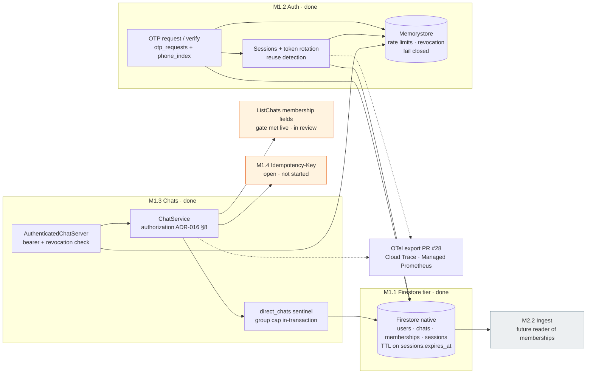

# Feature Dossier — Module 1: Identity & Membership

- **Status**: Living document (v1.4)
- **Created**: 2026-11-22
- **Covers**: M1.1 Firestore identity tier · M1.2 OTP, tokens and sessions · M1.3 chats and membership · `ListChats` membership fields
- **Plan authority**: [`docs/EXECUTION_PLAN.md`](../EXECUTION_PLAN.md) owns milestone status. This dossier explains features; it does not restate the ADRs.

> **What a Feature Dossier is.** Every PR that ships a feature or touches the execution plan carries one (Guiding Principle 9). Its job is to make a feature *understandable*: what problem it solves, which ADR sentences govern it, where the ideas come from outside this repo, what we doubt, what we actually measured, and what we cannot yet measure. ADR passages are quoted, never summarised. External sources are linked, and every link was fetched on 2026-11-22. Statements without a label are verified against code, git, committed evidence or a fetched source. **[Inference]** marks reasoning, and **[Doubt — mine]** marks a question the author proposes rather than one raised in discussion.

M1.1–M1.3 were written **retrospectively**, and `ListChats` forward from its live gate, which has since been met. Since v1.4 the dossier is also an **operating document**: every feature ends with *Verify and operate*, the commands that inspect its data, telemetry and code on a live stack, each shown with today's real output.

---

## Map



**How the pieces connect.** An OTP verification registers or logs in a user and creates a **session**. The access token (a JWT) carries the user and the session. Every chat RPC passes through `AuthenticatedChatServer`, which validates the token and checks the Redis revocation list; then `ChatService` authorizes the call against the caller's **membership** document. M2.2 will validate each message's sender with the same membership point lookup, `memberships/{chat_id}__{user_id}`, which is why M1.3 → M2.2 is on the critical path.

---

## Using the "Verify and operate" sections

Each feature ends with **Verify and operate**: the commands an operator runs against a live environment to see the feature's documents, its telemetry and its code. Every command shows what to expect and what it returned on **2026-11-22** against the PR #32 stack (images `3664e4e`), with an operator running each command and pasting its output.

- **Prerequisites:** a full `make deploy` (the logs, traces and metrics come from the deployed pod), then `export PROJECT_ID=<your project>` and run from the repo root.
- **The tool:** [`scripts/inspect.sh`](../../scripts/inspect.sh), which is read-only. It re-runs itself in the toolbox, flattens Firestore's typed values, replaces the project ID and project number with placeholders, and cuts secret-bearing values (`otp_mac`, token hashes, the log-only OTP code) to 8 characters. Its output is safe to paste into a published log.
- **Today's outputs** are shown as the tool printed them. Multi-line documents are collapsed to one line per document, and long UUIDs are cut to 8 characters (`8bb12951…`) where the full value adds nothing.
- **IDs used below:** user A `8bb12951-a86b-4a6f-9a04-e30e654fd906`, B `49d25070-2951-46ec-be78-669159815ac9`, C `0d102d9c-cb07-4e18-abd6-f16aca9d269a`; the group `6cd6c32d-810b-4246-bd83-cae37679110f`; direct A–B `290614a1-6932-4c3c-8e47-9fbe85c671f8` (opened by A) and direct C–A `2dba3049-05cc-411f-9e76-73ff28623efe` (opened by C). All come from the ListChats gate (`m1.3-listchats.log`).
- **Three operating facts learned while collecting these outputs:**
  - **Cloud Trace reads are scarce.** The read quota is 300 units per minute per project, and "A call to `ListTraces` consumes 25 quota units", which allows 12 calls a minute. The Console's Trace Explorer draws on the same quota, so one open tab can make the API return 429. `inspect.sh trace` retries a 429 three times, 20 s apart.
  - **Firestore's own metrics are queryable with PromQL**, as `firestore_googleapis_com:document_read_count`, and Google states "data is not visible for up to 240 seconds" after sampling.
  - **Cloud Logging maps the app's `level` to `severity`** (`WARN` → `WARNING`, `INFO` → `INFO`), so `severity>=WARNING` works in Logs Explorer.
- **Base Logging filter**, used by every Logging command below: `NS='resource.type="k8s_container" resource.labels.namespace_name="messaging"'`.
- **Dashboards:** none yet, deliberately deferred to the golden-signals work (open items). A dashboard now would chart counters whose names are about to change (the ADR-012 plane-prefix question) and would have no latency or per-RPC series to show, so it would freeze both gaps in place. The PromQL below is what a dashboard would be built from.

---

## M1.1 — Firestore identity tier

PR #14, merged 2026-07-26.

### Problem

Without a typed entity store there is nowhere authoritative to keep users, chats, memberships and sessions. Every later feature would read and write ad-hoc documents with no shared ID scheme, and "is X in chat Y?", the question M1.3 asks on every call and M2.2 will ask on every message, would need a query instead of a strongly consistent point lookup. Sessions would accumulate forever, or rely on a sweeper the project chose not to run.

### ADR context

- **ADR-021, Decision A** (Accepted): "**Decision A: a polyglot split** — Cloud SQL for PostgreSQL owns the ordered write path; Firestore (native mode) owns entity/document state."
- **ADR-023 v1.4, "Firestore model (identity & membership)"**: "**`sessions` TTL**: a **Firestore TTL policy on `expires_at`** replaces the DynamoDB `ttl` attribute — native, no sweeper. **But TTL deletion is not instantaneous** — Firestore removes expired documents within ~24 h of `expires_at`, so an expired session can still be *readable* for up to a day. The auth service therefore **must validate `expires_at` in application code** on every `get(sessions/{id})` and reject an expired session; TTL is garbage collection, never the correctness gate."
- **ADR-023 v1.4, "Cross-store integrity (application-enforced)"**: "the auth service **must** check `sessions.expires_at` in code on every `get(sessions/{id})` and reject an expired session. Firestore TTL (≤24 h lag) is garbage collection, never the correctness gate (see Firestore model)."

### Origins

| Source | What it actually says | Where we agree or differ |
|---|---|---|
| Google Cloud, *Firestore TTL* — https://cloud.google.com/firestore/docs/ttl | "Data is typically deleted within 24 hours after its expiration date." "Expired documents continue to appear in queries and lookup requests until the TTL process actually deletes them." | **Agree.** This is exactly why ADR-023 makes expiry an application check and TTL only collection. |
| Google Cloud, *Firestore best practices* — https://cloud.google.com/firestore/docs/best-practices | "Do not use monotonically increasing document IDs such as: `Customer1`, `Customer2`… Such sequential IDs can lead to hotspots that impact latency." | **Agree.** ADR-023 v1.1 chose UUID identifiers over ULIDs (whose time prefix is monotonic). The membership ID `{chat_id}__{user_id}` therefore starts with a random UUID. |
| Google Cloud, *Quotas and limits* — https://cloud.google.com/firestore/docs/quotas | Document IDs "Must be no longer than 1,500 bytes", "Cannot contain a forward slash", "Cannot match the regular expression `__.*__`". | **Agree.** The composite ID is 74 bytes and uses `__` only as an inner separator, never as a prefix/suffix pair. |
| HashiCorp, *`google_firestore_database`* — https://github.com/hashicorp/terraform-provider-google/blob/main/website/docs/r/firestore_database.html.markdown | "`deletion_policy` - (Optional) … Defaults to ABANDON. … When set to "ABANDON", the command will remove the resource from Terraform management" (it leaves the database in place). | **Differ, deliberately.** ABANDON makes `terraform destroy` report success while the database and its data survive. This repo sets `DELETE`, because every session must end at zero resources (ADR-021). |

### Doubts

- **[Doubt — mine, kept]** The ~6-minute Firestore field deletion dominates every teardown. Is that a fixed cost of the TTL field resource, or could the TTL policy be left in place across sessions without leaving a billable database behind? **Planned for the final teardown of the PR #32 session:** time each teardown phase; test removing the TTL fields from Terraform state (`terraform state rm`) before destroying the database; then verify through the API that nothing remains.
- **Answered:** does the M1.1 gate have committed evidence? Yes, except the destroy claim: [`m1.1-store.log`](../artifacts/evidence/m1.1-store.log) (2026-11-22).

### Experiments

- **Live gate** against `messaging-dev`, first run in July (recorded in `EXECUTION_PLAN.md`, M1.1 status line, with no log). **Re-run and logged 2026-11-22** in the PR #32 live session, operator-driven: `docs/artifacts/evidence/m1.1-store.log`. Observed:
  - both TTL policies, `sessions.expires_at` and `otp_requests.expires_at`, read back from the Admin API as `state: ACTIVE`;
  - the CRUD round-trip passes for all four collections (users, chats, memberships, sessions; 6.4 s in total);
  - the derived membership ID `{chat_id}__{user_id}` is **74 bytes** and serves the point lookup and both list directions from one document;
  - a session that expired an hour earlier still reads back, with `IsExpired` true;
  - five unknown or deleted lookups (user by phone, user by ID, chat, membership, session) wrap `domain.ErrNotFound`.
  - Not covered by the log: "destroy removes the database". It is checked at final teardown, together with the teardown-timing experiment from the first doubt above.
- **Overturned assumption: `terraform destroy` removes the database.** It does not by default. Measured, and fixed with `deletion_policy = DELETE`.
- **Overturned assumption: the ID is 54 bytes.** ADR-023 computed 54 bytes from ULIDs; with UUIDs it is 74. The plan's gate line carried the stale 54 until v2.8.
- **Measured: teardown time.** Deleting a `google_firestore_field` takes **~6 minutes**.

### Measurement

- **What shows it works:** unit tests for document shapes and tags (`internal/firestore/documents_test.go`), and the integration suites that every later module runs against the live database. These *use* M1.1's stores, so a broken store fails them.
- **Not measured:**
  - the destroy half of the M1.1 gate has no log yet (the rest is in `m1.1-store.log`);
  - no application metric for Firestore read/write counts or latency (Firestore's own project-wide counts are queryable; see Verify and operate);
  - no measurement of TTL lag (how long expired sessions actually linger).

### Notes

- **Index amplification:** both TTL fields carry `index_config {}`, which turns off the automatic single-field indexes on the monotonic `expires_at`. Those indexes would add index writes to every session and OTP write, and nothing queries by expiry. [Inference] Step 1 of `m1.1-store.log` is consistent with that setting having taken effect.

### Verify and operate

**Data.** Read one document from each collection, a membership by its derived ID, and a session with its `expires_at`. The TTL policies are read with `gcloud`, in the toolbox.

```bash
scripts/inspect.sh doc users/8bb12951-a86b-4a6f-9a04-e30e654fd906
scripts/inspect.sh doc chats/6cd6c32d-810b-4246-bd83-cae37679110f
scripts/inspect.sh doc memberships/6cd6c32d-810b-4246-bd83-cae37679110f__8bb12951-a86b-4a6f-9a04-e30e654fd906
scripts/inspect.sh where sessions user_id 8bb12951-a86b-4a6f-9a04-e30e654fd906
docker compose run --rm -T toolbox gcloud firestore fields ttls list \
  --database=messaging-dev --project="$PROJECT_ID" --format=yaml
```

- **Expected:**
  - **User:** `phone_verified: true` and an empty `display_name`, because OTP users have no profile yet.
  - **Group chat:** `member_count: 3` and no `participant_ids`.
  - **Membership:** an `id` that is the 74-byte composite, `role: owner`, and `muted_until` 24 h after the mute.
  - **Session:** `expires_at` 30 days after `created_at`, with token hashes masked.
  - **TTL policies:** both fields `state: ACTIVE`.
- **Today:**
  ```
  {"id":"users/8bb12951-…","updateTime":"2026-11-22T15:58:59.226298Z","fields":{"display_name":"","phone_number":"+525543450","phone_verified":true,"created_at":"2026-11-22T15:58:59.081335Z","updated_at":"2026-11-22T15:58:59.081335Z"}}
  {"id":"chats/6cd6c32d-…","updateTime":"2026-11-22T15:59:05.878702Z","fields":{"updated_at":"2026-11-22T15:59:05.808460Z","created_at":"2026-11-22T15:59:05.808460Z","name":"listchats gate","chat_type":"group","member_count":3,"created_by":"8bb12951-…"}}
  {"id":"memberships/6cd6c32d-810b-4246-bd83-cae37679110f__8bb12951-a86b-4a6f-9a04-e30e654fd906","updateTime":"2026-11-22T15:59:06.211316Z","fields":{"chat_id":"6cd6c32d-…","role":"owner","joined_at":"2026-11-22T15:59:05.808460Z","muted_until":"2026-11-23T15:59:06.186728Z","user_id":"8bb12951-…"}}
  {"id":"sessions/e2d2edfa-984c-46c1-9a73-449578dfff82","updateTime":"2026-11-22T15:58:59.226298Z","fields":{"user_id":"8bb12951-…","device_id":"lc-a","refresh_token_hash":"a4950cdf…","prev_token_hash":"…","token_generation":1,"created_at":"2026-11-22T15:58:59.081335Z","expires_at":"2026-12-22T15:58:59.081335Z"}}
  ```
  The TTL read-back is in [`m1.1-store.log`](../artifacts/evidence/m1.1-store.log): `ACTIVE` on both fields.
- **Reading it:**
  - The session expires exactly 30 days after `created_at`, and it shares the user's `updateTime`, because registration writes both in one commit (see M1.2).
  - The membership's `updateTime` is later than its `joined_at` because the mute rewrote the document.
  - `prev_token_hash: "…"` is an *empty* hash shown by an early version of the masking. The tool now prints `""`.

**Telemetry.**

| Signal | Query or filter | Expected | Today |
|---|---|---|---|
| PromQL, Firestore's own metric | `sum(increase(firestore_googleapis_com:document_read_count[6h]))` | non-zero | `313` |
| PromQL, Firestore's own metric | `sum(increase(firestore_googleapis_com:document_write_count[6h]))` | non-zero | `70` |
| Cloud Trace | `span:firestore.membership.get` (`inspect.sh trace '…'`) | a chat RPC containing one point read | `chat.mute` 45.9 ms → `firestore.membership.get` 17.7 ms (one `BatchGetDocuments`) + `firestore.membership.set_mute` 28.1 ms (one `Commit`); trace `a564c0b520efa5b46c43692fafd37332` |
| Cloud Logging | none | — | The stores don't log; a store error surfaces in the calling RPC's log line |

The Firestore counts are project-wide. They include the integration tests and the lookups above, not only the pod's traffic. M1.1 has no application metric of its own; that's listed under Measurement.

**Code.**
- [`internal/firestore/stores.go`](../../internal/firestore/stores.go): the four stores. `Memberships.Get`/`ListByChat`/`ListByUser` are the three access patterns served by one document.
- [`internal/firestore/collections.go`](../../internal/firestore/collections.go): `MembershipDocID` and `DirectChatDocID`, the only IDs this project constructs.
- [`internal/firestore/documents.go`](../../internal/firestore/documents.go): document shapes, and `SessionDoc.IsExpired`, the application-side expiry gate that TTL is not.
- The TTL policies themselves are infrastructure: [`terraform/modules/firestore/main.tf`](../../terraform/modules/firestore/main.tf).

---

## M1.2 — OTP, tokens and sessions

PR #15, merged 2026-07-26.

### Problem

Without authentication no other RPC can know who is calling, and every membership check downstream is meaningless. Each auth weakness has a specific consequence:
- **Unthrottled OTPs** can be brute-forced: six digits is a 10⁶ space.
- **Unrotated refresh tokens** turn one leaked token into a session that lasts 30 days, with no way to notice the theft.
- **A non-atomic registration** lets two first-time verifications for one phone number create two users.
- **A revocation check that "fails open"** when Redis is down silently honours logged-out tokens.

### ADR context

- **ADR-015 v1.4, §1.2 OTP Generation** (the procedure; storage re-homed by ADR-023 v1.2):
  > "1. otp = crypto/rand → uniform integer in [000000, 999999] … 3. expires_at = now + 5 minutes … ConditionExpression: attribute_not_exists(phone_hash) OR #status = "verified" OR #expires_at < :now (Prevents overwriting an active, unverified OTP)"
- **ADR-015 v1.4, §4.2 Rotation with Reuse Detection**:
  > "IF old_hash = session.prev_token_hash: → REUSE DETECTED: This is the immediately previous token being replayed. This likely indicates token theft … → REVOKE ENTIRE SESSION"
- **ADR-013, Security Authority Invariant**:
  > "Redis failures in security-critical paths MUST fail closed (deny access)"
- **ADR-023 v1.4, Firestore model:** the session-expiry rule quoted under M1.1 applies here too. Expiry is enforced in code; TTL only collects.

### Origins

| Source | What it actually says | Where we agree or differ |
|---|---|---|
| NIST SP 800-63B (Rev. 4) — https://pages.nist.gov/800-63-4/sp800-63b.html | For out-of-band authentication, "the authentication SHALL be considered invalid unless completed within 10 minutes." "If the authentication secret is less than 64 bits long, the verifier SHALL implement a rate-limiting mechanism that effectively limits the total number of consecutive failed authentication attempts… Generating a new authentication secret SHALL NOT reset the failed authentication count." It sets specific requirements for PSTN (SMS/voice) delivery in Sec. 3.1.3.3. | **Agree** on validity: our 5 minutes is inside the 10-minute ceiling. **Agree** that a 6-digit secret needs rate limiting: there are per-OTP attempt caps plus Redis phone/IP limits and a phone lockout. **Differ, possibly:** reissuing an OTP **resets** the per-OTP `attempt_count` (`internal/firestore/stores.go`), which NIST forbids for "the failed authentication count". Whether the Redis lockout bounds total consecutive failures across reissues is not verified (see Doubts). We send no SMS at all today (ADR-015 v1.3, `LogSMSProvider` only), so the PSTN requirements are not yet live. |
| RFC 9700, *OAuth 2.0 Security Best Current Practice*, §4.14 — https://www.rfc-editor.org/rfc/rfc9700 | §2.2.2: "Refresh tokens for public clients MUST be sender-constrained or use refresh token rotation." §4.14: "If a refresh token is compromised and subsequently used by both the attacker and the legitimate client, one of them will present an invalidated refresh token, which will inform the authorization server of the breach… it will revoke the active refresh token." | **Agree** on rotation and on revoking after a detected reuse; we revoke the whole session. **Differ in scope:** we detect reuse only for the *immediately previous* token (`prev_token_hash`). An older invalidated token is rejected with 401 but does **not** revoke the session. ADR-015 §4.2 justifies this by bounded storage. [Inference] This is a narrower reading than RFC 9700's "an invalidated refresh token". |
| RFC 7519, *JSON Web Token*, §4.1.4 — https://www.rfc-editor.org/rfc/rfc7519 | Defines the `"exp"` (Expiration Time) claim. | **Agree.** Access tokens carry `exp`; lifetime is `AccessTokenLifetime = 1 * time.Hour` (`internal/domain/constants.go`). |
| RFC 8725, *JWT Best Current Practices*, §3.1 — https://www.rfc-editor.org/rfc/rfc8725 | §3.1, "Perform Algorithm Verification": do not trust the token's own `alg` header. | **Agree.** The verifier pins `jwt.WithValidMethods([]string{"RS256"})` and type-checks the method (`internal/auth/jwt.go`). |

### Doubts

- **Answered:** is the deployed-flow gate evidenced, or only claimed? Evidenced: [`m1.2-flow.log`](../artifacts/evidence/m1.2-flow.log), all 7 steps (2026-11-22).
- **Answered, defect confirmed:** does reissuing an OTP reset the guess budget? The per-OTP count resets and the lockout never fires; the Redis per-phone limit still caps failures at 5 per 15 minutes: [`m1.2-otp-reissue.log`](../artifacts/evidence/m1.2-otp-reissue.log). The fix is an open item.
- RFC 9700 older-token reuse moved to [Open design questions](#open-design-questions).

### Experiments

- **`m1.2-store.log`** (captured 2026-08-04, live `messaging-dev`): **28 distinct top-level tests, 0 failures, 20.8 s.** That's the package's hermetic unit tests plus the live auth tests; the evidence README counts ten live ones. Shown:
  - a live OTP is refused while an expired one is replaced (the TTL-lag window);
  - attempt increments are atomic;
  - registration commits everything or nothing;
  - **concurrent registrations yield exactly one user**;
  - rotation is single-use;
  - `expires_at` survives the round trip byte-for-byte.
- **Overturned premise: "a query matching nothing locks nothing."** `rtm-04-negative-control*.log` (2026-08-07) measured the opposite on the registration path; RTM-04 claim C1 was withdrawn. `phone_index` is kept on other grounds (ADR-023 v1.4).
- **Defects only the live deploy found** (all fixed in PR #15):
  1. **Key discovery was ungrantable.** `secretmanager.secrets.list` can only be granted project-wide, so the pod crash-looped. Keys are now resolved by name.
  2. **A consumed OTP blocked reissue** for the rest of its 5-minute window. ADR-015's condition has three disjuncts; the code had two.
  3. **protojson dropped `false` booleans** from REST responses. The bridge now sets `EmitUnpopulated`.
- **`m1.2-flow.log`** (2026-11-22, deployed pod, PR #32 live session): the deployed flow gate. **All 7 steps pass:** OTP issued and read from the pod log; registration; consumed OTP refused on replay; second-device login recognised as a returning user; refresh rotates the tokens; replaying the spent refresh token is detected and **revokes the session**; logout; the per-phone OTP request limit enforced through Memorystore. Previously *pending*.
- **`m1.2-otp-reissue.log`** (2026-11-22, experiment). Four wrong guesses took `attempt_count` from 1 to 4. A reissue while the OTP was live returned the existing one. After the 5-minute expiry, the reissue **reset `attempt_count` to 0**. The next wrong guess got 401 (count 1), and every guess after that got **429**, from the Redis per-phone verify limit (5 per 15 minutes) rather than from the lockout. **Defect confirmed** against NIST SP 800-63B's "SHALL NOT reset the failed authentication count"; recorded as an open M1.2 defect in the plan, with the fix in its own PR.

### Measurement

- **What shows it works:**
  - The live store gate above.
  - The unit tests for every auth branch.
  - Six business counters:
    - `auth_otp_requests_total`, `auth_token_minted_total` and `auth_session_created_total`, labelled by `flow`/`status`;
    - `security_auth_failures_total`, with 9 `reason` values;
    - `security_rate_limits_total`;
    - `security_session_revocations_total`.
  - Spans `auth.request_otp`, `auth.verify_otp`, `auth.refresh_tokens` and `auth.logout`, with nested `firestore.*` and `redis.*` spans.
  - **Seen live in the backends** (`m1-telemetry.log`): an `auth.verify_otp` trace with its `redis.ratelimit.*`, `firestore.*` and Firestore SDK child spans. Its `trace_id` also appears on the matching `auth.otp_verified` and `session.created` log lines, found with `jsonPayload.trace_id="…"`. `auth_otp_requests_total{status="success"}` = 7 in Managed Prometheus, matching the successful OTP requests sent.
- **Not measured:**
  - no auth latency metric (no histogram exists anywhere); span durations are visible in Cloud Trace only;
  - no test that Redis being down really denies access end-to-end (unit-tested only);
  - whether the per-15-minute verify limit bounds consecutive failures over longer horizons (the reissue probe covers one window).

### Verify and operate

**Data.** An `otp_requests` document is keyed by `sha256(phone)`; `inspect.sh` computes the hash. The first command reads the document left by the reissue probe, the second reads one that a user verified, and the third reads that user's `phone_index` sentinel. Sessions are read as in M1.1.

```bash
scripts/inspect.sh otp +525599990077     # the reissue-probe phone
scripts/inspect.sh otp +525543450        # user A's phone
scripts/inspect.sh phone +525543450      # A's uniqueness sentinel
```

- **Expected:**
  - **Probe OTP:** `pending` with a low `attempt_count`, past its `expires_at`.
  - **A's OTP:** `verified`, `attempt_count: 0`, still readable after expiry, because TTL collects within about 24 hours.
  - **Sentinel:** `user_id` is A, and `created_at` equals A's.
- **Today:**
  ```
  {"id":"otp_requests/d78493373a0bb17ce7d48b8b3f15ff113d48b3bc0a7bb3bd666c1a0813994c2f","updateTime":"2026-11-22T16:04:40.891432Z","fields":{"expires_at":"2026-11-22T16:09:36Z","created_at":"2026-11-22T16:04:36Z","otp_mac":"16888115…","attempt_count":1,"status":"pending"}}
  {"id":"otp_requests/4f5468b22c2bc1930dce994cd680ac7aac4843ff1dd36452330473fa2807d1be","updateTime":"2026-11-22T15:58:59.226298Z","fields":{"attempt_count":0,"otp_mac":"bcb25535…","expires_at":"2026-11-22T16:03:56Z","created_at":"2026-11-22T15:58:56Z","status":"verified"}}
  {"id":"phone_index/4f5468b22c2bc1930dce994cd680ac7aac4843ff1dd36452330473fa2807d1be","updateTime":"2026-11-22T15:58:59.226298Z","fields":{"user_id":"8bb12951-…","created_at":"2026-11-22T15:58:59.081335Z"}}
  ```
- **Reading it:**
  - **Atomic registration, visible in the data.** The OTP marked `verified`, the `phone_index` sentinel, the user and the session (M1.1) all carry `updateTime` `15:58:59.226298Z`: one commit. That is "registration commits everything or nothing".
  - **The probe's `attempt_count: 1`** is the defect's footprint. The reissue reset the count, and the Redis limit refused the remaining guesses before they were counted.

**Telemetry.**

| Signal | Query or filter | Expected | Today (cumulative since the pod started, ~15:58) |
|---|---|---|---|
| PromQL | `sum by (status) (auth_otp_requests_total)` | `success`, plus `existing` for a live-OTP reissue | `existing` 1, `success` 8 |
| PromQL | `sum by (flow) (auth_session_created_total)` | `registration` and `login` | `login` 1, `registration` 4 |
| PromQL | `sum by (reason) (security_auth_failures_total)` | `invalid_otp`, `refresh_token_reuse` | `invalid_otp` 6, `refresh_token_reuse` 1, `session_expired` 1 |
| PromQL | `sum by (endpoint, limit_type) (security_rate_limits_total)` | a verify limit (probe) and a request limit (flow) | `request_otp`/`phone` 1, `verify_otp`/`phone` 5 |
| PromQL | `sum by (reason) (security_session_revocations_total)` | reuse detection, logout | `logout` 1, `reuse_detection` 1 |
| Cloud Trace | `root:auth.refresh_tokens` | `firestore.session.get`, then a rotate | `auth.refresh_tokens` 7.2 ms → `firestore.session.get` 6.9 ms, **no rotate**; trace `392da3e3caf58878ce883042f7399843` |
| Cloud Trace | `root:auth.verify_otp` | `redis.ratelimit.*` and `firestore.*` children | In [`m1-telemetry.log`](../artifacts/evidence/m1-telemetry.log): trace `30de4a495382e5917d6fc58952c12b45` |
| Cloud Logging | `"$NS jsonPayload.msg=\"auth.refresh_token_reuse\""` | one `WARN` line | `{"severity":"WARNING","level":"WARN","msg":"auth.refresh_token_reuse","session_id":"ab12c5ca-…","trace_id":"e52b928f36cc660d4acf5d7bd5633df1","user_id":"bab5db2d-…",…}` at 15:59:22 |
| Cloud Logging | `"$NS jsonPayload.trace_id=\"392da3e3caf58878ce883042f7399843\""` | the refresh's log lines | **nothing** |

- **Reading it, two findings recorded as open items:**
  - **The latest refresh trace stops after `firestore.session.get`.** That is the branch where the session document is not found, and it is counted as `security_auth_failures_total{reason="session_expired"}` (`internal/chatmgmt/app/auth_refresh.go:38`). [Inference] It is the flow's refresh after reuse detection had revoked the session, so **a revoked session is counted as an expired one**.
  - **That refused refresh wrote no log line at all.** Its `trace_id` matches nothing in Cloud Logging; only the metric records it.

**Code.**
- [`internal/chatmgmt/app/auth_verify_otp.go`](../../internal/chatmgmt/app/auth_verify_otp.go): `VerifyOTP`, covering rate limits, lockout, the attempt counter, and the registration or login branch.
- [`internal/chatmgmt/app/auth_refresh.go`](../../internal/chatmgmt/app/auth_refresh.go): `RefreshTokens`, covering the expiry check, rotation, and reuse detection that revokes the session.
- [`internal/firestore/auth_tx.go`](../../internal/firestore/auth_tx.go): `Register` and `Login`, the single-commit transactions seen in the data above.

---

## M1.3 — Chats and membership

PRs #22, #24–#29 (2026-08-12 to 2026-09-20); #23 is the ADR-023 v1.4 amendment. Plan status: ✅ Done, gate met (v2.8).

### Problem

Without a chat lifecycle there is nothing to send messages *to*, and without membership there is nothing to authorize against. Each missing piece has a specific failure:
- **Two clients opening the same direct chat concurrently** would create two chat IDs. Each would get its own message sequence and history, while both users believe they are talking to each other. That failure can't be repaired after the fact.
- **A group cap enforced outside a transaction** can be overrun by concurrent adds.
- **Authorization based on the caller's claims** rather than the stored membership lets anyone mutate any chat.
- **M2.2 has nothing to read:** it needs a cheap, strongly consistent "is this sender a member?".

### ADR context

- **ADR-016 v1.2, §8 Authorization Decision Matrix**:
  > "All checks are performed by the Chat Mgmt Service with `ConsistentRead=true` on the caller's membership record"

  The same matrix records "Leave chat | ❌ (must transfer first)" for the owner. The DynamoDB term `ConsistentRead` maps to Firestore's strongly consistent point reads.
- **ADR-023 v1.4, Firestore model, `direct_chats`**:
  > "**It is a lookup, not only a sentinel.** It carries `chat_id`, which is what makes "which chat does this pair have?" a single strongly consistent `get()` on a deterministic path."

  And:
  > "**The sentinel is measured not to fire, and that is recorded rather than hidden.** In the same run, `tx.Create` on the sentinel refused **zero** racers across all thirty repetitions."
- **ADR-006 v1.2, §4.1 Create Chat**: an existing direct chat "Returns **200 OK** with the existing chat (not 409)".

### Origins

| Source | What it actually says | Where we agree or differ |
|---|---|---|
| Google Cloud, *Transaction serializability and isolation* — https://cloud.google.com/firestore/docs/transaction-data-contention | "With pessimist concurrency controls, transactions place locks on the documents they read. A transaction's lock on a document blocks other transactions, batched writes, and non-transactional writes from changing that document." Also: "The mobile and web SDKs behave independently of this setting as they always emulate optimistic concurrency." | **Agree.** The group cap reads `chats/{chat_id}` inside the transaction, which relies on exactly this documented lock. **Differ, knowingly:** we measured that a query matching nothing was *also* protected, which the page neither promises nor denies. ADR-023 v1.4 therefore does not rely on it. |

[Inference] The direct-pair sentinel follows the uniqueness-claim pattern ("insert a key whose existence is the lock"). I found no single primary source that names it, so none is cited.

### Doubts

- Chat Mgmt's plane and metric naming moved to [Open design questions](#open-design-questions).
- **Parked:** a sentinel *negative control*. The sentinel was measured never to fire (0 of 30), so removing it changes nothing a control could detect. Re-open if the sentinel ever becomes the mechanism that refuses.

### Experiments

- **`m1.3-direct-pair-{pessimistic,optimistic}.log`** (2026-08-10, experiment, not a gate):
  - the naive design produced **exactly one chat in 15/15 repetitions in both concurrency modes**;
  - the query-deleted control produced five chats every time;
  - the sentinel's `tx.Create` refused **zero** racers in 30.

  **Overturned premise:** ADR-023 v1.3's reason for the sentinel was measured false. The sentinel was kept on grounds that don't depend on the race (ADR-023 v1.4).
- **`m1.3-store.log`** (2026-08-11): the chat-store gate, 30 PASS lines, 0 failures. Concurrent direct creation gives exactly one chat, with the refusing mechanism recorded.
- **`m1.3-store-membership.log`** (2026-09-20): membership operations and the service-to-adapter seam, 58 PASS lines, 0 failures. Covers the group cap with the count still exact, direct-chat immutability, and the indefinite-mute sentinel surviving a live round trip.
- **`m1.3-flow.log`** (2026-09-20, against the **deployed pod** at commit `4ecf4c9`): 22 passing steps over REST, including "member left; the owner was refused".
- **Found by the measurement discipline itself:** the gate now has to *record which mechanism refused*. A gate that accepts any refusal would certify the sentinel while never exercising it (RTM-04 C7).

### Measurement

- **What shows it works:**
  - the four live logs above;
  - unit tests for authorization branches, validation and error mapping (190 unit tests on `main`, repo-wide);
  - counters `chat_created_total`, `direct_chat_dedup_total`, `chat_authz_denials_total` and `membership_mutation_total`;
  - spans `chat.*` with nested `firestore.chat.*` and `firestore.membership.*`.
- **Not measured:**
  - per-RPC latency, request rate and error rate (no server instrumentation; `grpc.NewServer()` is called bare);
  - the read cost of `GetChat` (one user read per member);
  - any load behaviour (no traffic generator beyond the flow script).

### Verify and operate

**Data.** The first command reads the `direct_chats` lookup for a pair; `inspect.sh pair` sorts the two IDs, so their order doesn't matter. The second reads the chat it points to, and the third lists a group's members.

```bash
scripts/inspect.sh pair 49d25070-2951-46ec-be78-669159815ac9 8bb12951-a86b-4a6f-9a04-e30e654fd906
scripts/inspect.sh doc chats/290614a1-6932-4c3c-8e47-9fbe85c671f8
scripts/inspect.sh where memberships chat_id 6cd6c32d-810b-4246-bd83-cae37679110f
```

- **Expected:**
  - **Pair document:** `chat_id` names the direct chat.
  - **Direct chat:** `participant_ids` holds the sorted pair, and the chat shares the pair document's `updateTime`.
  - **Group members:** three memberships; the owner is muted, B and C are not.
- **Today:**
  ```
  {"id":"direct_chats/49d25070-2951-46ec-be78-669159815ac9__8bb12951-a86b-4a6f-9a04-e30e654fd906","updateTime":"2026-11-22T15:59:06.448209Z","fields":{"chat_id":"290614a1-6932-4c3c-8e47-9fbe85c671f8","created_at":"2026-11-22T15:59:06.382593Z"}}
  {"id":"chats/290614a1-…","updateTime":"2026-11-22T15:59:06.448209Z","fields":{"updated_at":"2026-11-22T15:59:06.382593Z","created_by":"8bb12951-…","created_at":"2026-11-22T15:59:06.382593Z","member_count":2,"name":"","participant_ids":["49d25070-2951-46ec-be78-669159815ac9","8bb12951-a86b-4a6f-9a04-e30e654fd906"],"chat_type":"direct"}}
  {"id":"memberships/6cd6c32d-…__0d102d9c-…","updateTime":"2026-11-22T15:59:05.878702Z","fields":{"user_id":"0d102d9c-…","role":"member","joined_at":"2026-11-22T15:59:05.808460Z","muted_until":null,"chat_id":"6cd6c32d-…"}}
  {"id":"memberships/6cd6c32d-…__49d25070-…","updateTime":"2026-11-22T15:59:05.878702Z","fields":{"chat_id":"6cd6c32d-…","user_id":"49d25070-…","role":"member","joined_at":"2026-11-22T15:59:05.808460Z","muted_until":null}}
  {"id":"memberships/6cd6c32d-…__8bb12951-…","updateTime":"2026-11-22T15:59:06.211316Z","fields":{"chat_id":"6cd6c32d-…","user_id":"8bb12951-…","role":"owner","joined_at":"2026-11-22T15:59:05.808460Z","muted_until":"2026-11-23T15:59:06.186728Z"}}
  ```
- **Reading it:**
  - **One transaction per creation.** The direct chat and its pair document share commit `15:59:06.448209Z`, and all three group memberships carry the group's creation time. B's and C's memberships also carry its commit, `.878702`.
  - **A's `updateTime` is later** because the mute rewrote that document.

**Telemetry.**

| Signal | Query or filter | Expected | Today |
|---|---|---|---|
| PromQL | `sum by (chat_type) (chat_created_total)` | direct 2, group 1 (the gate's chats) | `direct` 2, `group` 1 |
| PromQL | `sum by (result) (direct_chat_dedup_total)` | `created` 2, no `existing` | `created` 2 |
| PromQL | `sum by (change_type) (membership_mutation_total)` | the mute | `muted` 1 |
| Cloud Trace | `root:chat.create` | the transaction, then the response's reads | `chat.create` 192.7 ms → `firestore.chat.create_direct` 146.2 ms (`BeginTransaction` 73.5, `BatchGetDocuments` 28.7, `Commit` 43.7), then `firestore.membership.list_by_chat` 24.5 ms, then **`firestore.user.get` twice, one after the other** (7 ms, 14.9 ms); trace `2dc313a50d7e699f10db9e098003d9a1` |
| Cloud Logging | `"$NS jsonPayload.msg=\"chat.create\""` (limit 3) | one line per create, with `existing` | 3 lines: `direct` `2dba3049…` (caller C, `trace_id` `2dc313a5…`), `direct` `290614a1…` (caller A), `group` `6cd6c32d…` (caller A); all `"existing":false`, `severity` `INFO` |

- **Reading it:**
  - The `chat.create` log line and the trace share `trace_id` `2dc313a5…`, so log and trace correlate for M1.3.
  - Building the create response costs **one user read per member, in sequence**. That's the per-member read cost Measurement already lists for `GetChat`, now seen in `CreateChat` as well. It is recorded as an open item.
  - `direct_chat_dedup_total` is labelled `result`. Summed without the label, it reads as "2 dedups"; the label says neither was a dedup.

**Code.**
- [`internal/chatmgmt/app/chat_service.go`](../../internal/chatmgmt/app/chat_service.go): `CreateChat` and the ADR-016 §8 authorization checks against the stored membership.
- [`internal/firestore/chat_tx.go`](../../internal/firestore/chat_tx.go): `CreateDirect` (the `direct_chats` lookup and sentinel), `CreateGroup`, and the in-transaction group cap in `AddMember`.
- [`internal/chatmgmt/port/authenticated_chat.go`](../../internal/chatmgmt/port/authenticated_chat.go): `authenticate`, which checks the bearer token and the Redis revocation list before any chat RPC.

---

## `ListChats` membership fields (M1.3 open item 1)

**Status:** implemented in the same PR as this dossier (`feat/m1.3-listchats-membership`, not yet merged). CI is green (198 tests, lint, `buf breaking`). **The live gate was met on 2026-11-22** against the deployed pod (`m1.3-listchats.log`). This section was written forward from the gate; its Experiments and Measurement now record what the gate showed.

### Problem

ADR-006 §4.2's chat list shows each chat *as the caller sees it*: their role, when they joined, whether they muted it, and, for a direct chat, who the other person is. Without those fields:
- a client can't render a chat list without an extra `GetChat` per row;
- a direct chat has no name to display, since direct chats are unnamed;
- the mute state is invisible.

Before this change, `ListChats` also read one chat document per round trip (a `GetChat` per membership).

### ADR context

- **ADR-006 v1.2, §4.2 List Chats, notes:**
  > "For direct chats, `other_member` provides the other participant's info"

  And:
  > "Results ordered by `updated_at` descending (most recent first)"

  The second is not yet true (see Open items).
- **ADR-023 v1.4, `direct_chats` point 1:**
  > "a query needs the pair key stored on the chat document, which is the disclosure problem below."
- **ADR-023 v1.5, same point, clarification** (added in this PR):
  > "The disclosure argument below is about a chat **ID** derived from its members, because the ID travels: REST paths, the Kafka partition key, lake rows, client caches. It does not forbid recording the pair as a **field**, and v1.5 does exactly that with `participant_ids`"
- **ADR-023 v1.5, Firestore model table, `chats` row:**
  > "`participant_ids` (direct chats only: the sorted pair, v1.5)"

### Origins

| Source | What it actually says | Where we agree or differ |
|---|---|---|
| Google Cloud, *`projects.databases.documents.batchGet`* — https://cloud.google.com/firestore/docs/reference/rest/v1/projects.databases.documents/batchGet | "Gets multiple documents. Documents returned by this method are not guaranteed to be returned in the same order that they were requested." | **Agree, by construction.** The design keys results by document ID and re-walks the membership order, so it never depends on the API's order. |
| Go client, *`Client.GetAll`* — https://pkg.go.dev/cloud.google.com/go/firestore#Client.GetAll | "The DocumentSnapshots are returned in the order of the given DocumentRefs. The return value will always contain the same number of DocumentSnapshots as the number of DocumentRefs." A missing document is reported through `Exists()`, not as an error. | **Agree.** "A missing chat is skipped and logged" is implemented as filtering out `!Exists()`. The ordering guarantee belongs to the client library, not the wire API, which is why we don't rely on it. |

### Doubts

- **Parked:** a 500-document batch read (`MaxConcurrentChats`). Neither source above states a per-call maximum. Exercising it needs a harness that seeds 500 memberships, which belongs with load tooling rather than this gate.
- The deprecated `chats` field (it doubles the payload) is now an open item: deciding when to remove it needs a signal that no client still reads it.

### Experiments (the gate, run 2026-11-22)

The gate ran against the **full deployed stack**, through the REST API, instead of the planned Firestore-only store suite. That's a stronger test of the same behaviour: it goes through the real `AuthenticatedChatServer`, the REST bridge and the JSON rendering. Evidence: `m1.3-listchats.log`, from `scripts/chat.sh listchats` plus `listchats-cost`, apparatus commit `8651af2`.

1. **Setup:** A, B and C registered through OTP. A created a group with B and C and muted it for 24 hours. A opened a direct chat with B; **C opened** a direct chat with A.
2. **`GET /v1/chats` as A returned 3 items:**
   - **group:** `myMembership.role = MEMBER_ROLE_OWNER`, `mutedUntil` present, `otherMember` null;
   - **direct with B** (opened by A): `role = MEMBER_ROLE_MEMBER`, `otherMember.userId` = B;
   - **direct with C** (opened by C): `role = MEMBER_ROLE_MEMBER`, `otherMember.userId` = C, so the peer-opened case resolves correctly;
   - every item carries `joinedAt`;
   - the deprecated `chats` is populated in the same order as `items`.
3. **Read cost, from the `chat.list` span tree in Cloud Trace:** exactly **3 Firestore spans** for the page: `firestore.membership.list_by_user` (one `RunQuery`), `firestore.chat.get_many` (one `BatchGetDocuments`) and `firestore.user.get_many` (one `BatchGetDocuments`). **50.7 ms** end to end, with no per-chat reads.
4. **Observed, not a defect:** `otherMember.displayName` is `""`, because users registered through OTP have no display name yet (no profile endpoint). Unmuted items **omit** `mutedUntil` instead of returning `null`, the API-wide JSON divergence already recorded in Open items.
5. **Not run separately:** the store-level `TestServiceListChatsMixedPage` / `TestStoreGetManySkipsMissingChats`. The deployed run supersedes them for this gate. The missing-chat skip is covered by unit tests only.

### Measurement

- **What shows it works:** the live gate above, the port JSON-shape test, the drift-guard test, and the unit tests proving one batched chat read, no per-chat reads and one batched user read.
- **Read cost, measured:** 3 round trips for a page of 3 chats (2 direct), 50.7 ms, from one trace. The design cost is 2M + D document reads in at most three round trips.
- **Not measured:** latency at 500 chats (only a 3-chat page ran); actual Firestore *document* read counts (the trace shows calls, not documents); the payload size with both `chats` and `items`; the missing-chat skip against a live store.

### Verify and operate

**Data.** These commands reproduce by hand what one `GET /v1/chats` reads: the caller's memberships (read 1), one of the chats (read 2, batched), and the pair it came from. The chosen chat is the peer-opened direct chat, the case where `participant_ids` is the only way to name `otherMember`.

```bash
scripts/inspect.sh where memberships user_id 8bb12951-a86b-4a6f-9a04-e30e654fd906
scripts/inspect.sh doc chats/2dba3049-05cc-411f-9e76-73ff28623efe
scripts/inspect.sh pair 0d102d9c-cb07-4e18-abd6-f16aca9d269a 8bb12951-a86b-4a6f-9a04-e30e654fd906
```

- **Expected:**
  - **A's memberships:** three documents, the same set as the 3 items in `m1.3-listchats.log`.
  - **Chat `2dba3049…`:** `created_by` is C, and `participant_ids` minus A is C.
  - **Pair document:** points to the same chat.
- **Today:**
  ```
  {"id":"memberships/290614a1-…__8bb12951-…","updateTime":"2026-11-22T15:59:06.448209Z","fields":{"chat_id":"290614a1-…","user_id":"8bb12951-…","role":"member","joined_at":"2026-11-22T15:59:06.382593Z","muted_until":null}}
  {"id":"memberships/2dba3049-…__8bb12951-…","updateTime":"2026-11-22T15:59:06.867636Z","fields":{"chat_id":"2dba3049-…","user_id":"8bb12951-…","role":"member","joined_at":"2026-11-22T15:59:06.725594Z","muted_until":null}}
  {"id":"memberships/6cd6c32d-…__8bb12951-…","updateTime":"2026-11-22T15:59:06.211316Z","fields":{"chat_id":"6cd6c32d-…","user_id":"8bb12951-…","role":"owner","joined_at":"2026-11-22T15:59:05.808460Z","muted_until":"2026-11-23T15:59:06.186728Z"}}
  {"id":"chats/2dba3049-…","updateTime":"2026-11-22T15:59:06.867636Z","fields":{"created_by":"0d102d9c-cb07-4e18-abd6-f16aca9d269a","updated_at":"2026-11-22T15:59:06.725594Z","name":"","participant_ids":["0d102d9c-cb07-4e18-abd6-f16aca9d269a","8bb12951-a86b-4a6f-9a04-e30e654fd906"],"chat_type":"direct","created_at":"2026-11-22T15:59:06.725594Z","member_count":2}}
  {"id":"direct_chats/0d102d9c-cb07-4e18-abd6-f16aca9d269a__8bb12951-a86b-4a6f-9a04-e30e654fd906","updateTime":"2026-11-22T15:59:06.867636Z","fields":{"created_at":"2026-11-22T15:59:06.725594Z","chat_id":"2dba3049-05cc-411f-9e76-73ff28623efe"}}
  ```
- **Reading it:**
  - **The peer-opened case is real.** `created_by` is C, so naming C as `otherMember` could only come from `participant_ids`.
  - **One commit for the whole create.** The chat, its pair document and A's membership share `updateTime` `15:59:06.867636Z`.
  - **The membership query returns document-ID order** (`290614…`, `2dba…`, `6cd6…`), and it's the same order as the gate's ListChats items. That confirms the open item: ListChats is not yet ordered by `updated_at`.

**Telemetry.**

| Signal | Query or filter | Expected | Today |
|---|---|---|---|
| PromQL | none | — | ListChats has no metric of its own; its signal is the trace |
| Cloud Trace | `root:chat.list` | at most 3 Firestore spans | `chat.list` 50.7 ms → `firestore.membership.list_by_user` 16.5 ms (`RunQuery`), `firestore.chat.get_many` 26.4 ms (`BatchGetDocuments`), `firestore.user.get_many` 7.8 ms (`BatchGetDocuments`); trace `2c3f3d8b8ce41c9236e64a4fb5fafb73`, the gate's own |
| Cloud Logging | `"$NS jsonPayload.trace_id=\"2c3f3d8b8ce41c9236e64a4fb5fafb73\""` | — | nothing: `chat.list` doesn't log, and a successful read has nothing to say |

**Code.**
- [`internal/chatmgmt/app/chat_service.go`](../../internal/chatmgmt/app/chat_service.go): `ListChats`, which runs the three reads, keys the results by ID and re-walks the membership order.
- [`internal/firestore/stores.go`](../../internal/firestore/stores.go): `Chats.GetMany`, `Users.GetMany` and the shared `getMany`, which drops missing documents (the `!Exists()` skip).
- [`internal/chatmgmt/port/chat_handler.go`](../../internal/chatmgmt/port/chat_handler.go): `chatListItemToProto`, the per-caller fields `myMembership`, `otherMember` and `mutedUntil`.

---

## Open design questions

Questions that span the module and need a decision rather than a measurement. Each was raised in discussion or by the author, and none is settled.

1. **Which plane owns Chat Mgmt, and what does that mean for metric naming?** (from voice discussion, 2026-11-22)
   - ADR-002's design sections are only "Connection Plane", "Durability Plane" and "Fanout Plane", and the document **never mentions Chat Mgmt** (verified by text search).
   - ADR-012 §1.3 requires `<plane>_<subsystem>_<metric>_<unit>`, with prefixes `gateway_`, `durability_`, `fanout_` and `messaging_`. Today's chat and auth counters (`chat_created_total`, `auth_otp_requests_total`, `security_auth_failures_total`, …) fit none of them.
   - **[Doubt — mine]** The options are a fourth "control" or "identity" plane in ADR-002; folding Chat Mgmt into Durability, since it owns entity state; or treating it as outside the planes, with an ADR-012 prefix of its own. Each implies a rename, or a documented exception, for 10 existing counters, and it blocks the golden-signals work and its dashboard.
2. **What is the unit being measured?** (from voice discussion, 2026-11-22)
   - Today's counters count **events**: an OTP request, a token mint, a membership change. ADR-012's SLOs are written per **request**, as latency histograms. Gates count **operations under concurrency**. None counts per **user** or per **chat**, and ADR-012 §1.3 forbids `user_id`/`chat_id` labels because of cardinality.
   - **[Doubt — mine]** For Module 1 the natural SLO unit is the *RPC request*, split by method and status, which is what `otelgrpc` would produce. Per-user or per-chat questions belong in traces and logs, as ADR-012 already says.
3. **Should any invalidated refresh token revoke the session, not only the immediately previous one?** RFC 9700 treats any invalidated refresh token as evidence of a breach; ADR-015 §4.2 acts only on `prev_token_hash`, on bounded-storage grounds. **[Doubt — mine]** Is that argument still right now that sessions live in Firestore, which could hold a short history? (See M1.2 Origins.)

**Answered across the module:** is telemetry reaching Cloud Trace and Managed Prometheus re-checkably? Yes: [`m1-telemetry.log`](../artifacts/evidence/m1-telemetry.log) (raw API responses, `scripts/telemetry-proof.sh`), and every feature's Verify and operate section above re-checks it. A gate that *asserts* a counter delta is still an open item.

---

## Lessons

1. **We wired the pipe before deciding what to put in it.** PR #28 connected OpenTelemetry export to Cloud Trace and Managed Prometheus, and that was verified live. But nobody had decided what Module 1 *should* measure:
   - there is no latency histogram;
   - there is no per-RPC traffic or error signal;
   - the metric names don't fit ADR-012's plane prefixes.

   Export without a measurement design produces data that answers no question.
2. **Gates must name the mechanism, not just the outcome.** "Exactly one chat" passed while the sentinel the design relied on never fired (zero of 30). Recording *which* refusal happened turned a passing gate into an actual measurement (RTM-04 C7).
3. **Measure premises before building on them.** Twice ("a query matching nothing locks nothing", on registration and on direct chats) the reason in the ADR was measured false. In the direct-chat case it was caught *before* the code was written, because the negative control ran first.
4. **Some defects only exist in a live deploy:** the ungrantable `secrets.list` permission, the consumed-OTP reissue block, and the missing `false` booleans. Unit tests could not have found them.
5. **A claim without an artifact decays.** The M1.2 flow gate, the M1.1 gate and the PR #28 telemetry check were asserted in prose, with no log, until the PR #32 live session captured them. PRs #22 and #24–#29 landed without plan updates, so the plan was stale until v2.8.
6. **A passing Go test is silent by convention, so it is not evidence on its own.** `go test` prints only failures, and `t.Log` output appears only under `-v` or on failure. M1.1's round-trip tests asserted the 74-byte ID, `IsExpired` and `ErrNotFound`, and a passing run printed none of them. When a test is used as evidence, run it with `-v` **and** log the observed values explicitly (`t.Logf` next to the assertion, as in `1f6397e`), so the log shows what was measured and not just that nothing failed.

---

## Open items carried forward

| Item | Owner | Notes |
|---|---|---|
| `ListChats` membership fields: merge | M1.3 open item 1 | Live gate met 2026-11-22 (`m1.3-listchats.log`); in review |
| `ListChats` `last_message`, `pending_ack_count` | waits on M2.2 / `delivery_state` | Need the Postgres tables |
| `GetMessages` | M5.2 | Served through Ingest `ReadMessages` (ADR-006 v1.2 §5) |
| REST Idempotency-Key | M1.4 | ADR-006 v1.1 §10.4–§10.5 |
| `ListChats` pagination ordered by `updated_at` | unassigned | Today: no pagination, document-ID order |
| REST JSON conventions vs ADR-006 (envelope, camelCase, enum names, `Timestamp` shape, omitted unset optionals) | unassigned | Affects every endpoint |
| An M1.1 gate log | done, except destroy | `m1.1-store.log` (2026-11-22). The destroy claim is checked at final teardown |
| A telemetry *gate* that asserts the counter delta | unassigned | A re-checkable proof is committed (`m1-telemetry.log`), but it reports rather than asserts |
| Golden signals: ADR-012 naming decision (plane for Chat Mgmt), then `otelgrpc`, then a dashboard | unassigned | Open design questions 1 and 2. The dashboard waits on both (see "Using the Verify and operate sections") |
| Remove the deprecated `ListChats` `chats` field | unassigned | It doubles the payload. Removing it needs a signal that no client still reads it |
| **Metric label conflation:** a refresh whose session document is missing (revoked) is counted as `security_auth_failures_total{reason="session_expired"}` | unassigned | Observed 2026-11-22 (M1.2 Verify and operate); `internal/chatmgmt/app/auth_refresh.go:38`. Recorded, not fixed |
| **A refused refresh writes no log line** | unassigned | Observed 2026-11-22: trace `392da3e3…` has no matching Cloud Logging entry; only the metric records it. Recorded, not fixed |
| `CreateChat` builds its response with one sequential user read per member | unassigned | Observed in the `chat.create` trace (2 × `firestore.user.get`); the same cost Measurement lists for `GetChat`. A batched read would match `ListChats` |
| **M1.2 defect (confirmed):** reissuing an OTP resets the per-OTP failed-attempt count, which NIST SP 800-63B forbids | unassigned (plan, M1.2 open defect) | Confirmed live (`m1.2-otp-reissue.log`): the count resets 4 → 0 and the lockout never fires; the Redis verify limit still caps at 5 per 15 minutes. The fix goes in its own PR |
| **Outdated comment:** `internal/observability/{tracer,metrics}.go` say GKE Managed OpenTelemetry has no gRPC endpoint; Google now lists `:4317` | unassigned (plan, M1.3 open item 7) | Recorded, not fixed. The HTTP exporters still work |

---

## References

**Repository (internal):** [ADR-002](../adr/ADR-002.md), [ADR-006](../adr/ADR-006.md), [ADR-012](../adr/ADR-012.md), [ADR-013](../adr/ADR-013.md), [ADR-015](../adr/ADR-015.md), [ADR-016](../adr/ADR-016.md), [ADR-021](../adr/ADR-021.md), [ADR-023](../adr/ADR-023.md), [Execution plan](../EXECUTION_PLAN.md), [evidence logs](../artifacts/evidence/README.md), [RTM-04](../artifacts/RTM-04.md).

**External (each fetched 2026-11-22; some cloud.google.com links redirect to docs.cloud.google.com):**
- Google Cloud — Firestore TTL: https://cloud.google.com/firestore/docs/ttl
- Google Cloud — Firestore best practices: https://cloud.google.com/firestore/docs/best-practices
- Google Cloud — Firestore quotas and limits: https://cloud.google.com/firestore/docs/quotas
- Google Cloud — Transaction serializability and isolation: https://cloud.google.com/firestore/docs/transaction-data-contention
- Google Cloud — Firestore REST `batchGet`: https://cloud.google.com/firestore/docs/reference/rest/v1/projects.databases.documents/batchGet
- Google Cloud — Managed OpenTelemetry for GKE (concepts): https://cloud.google.com/kubernetes-engine/docs/concepts/managed-otel-gke
- Google Cloud — Managed OpenTelemetry for GKE (how-to): https://cloud.google.com/kubernetes-engine/docs/how-to/managed-otel-gke
- Go client `Client.GetAll`: https://pkg.go.dev/cloud.google.com/go/firestore#Client.GetAll
- HashiCorp — `google_firestore_database` docs source: https://github.com/hashicorp/terraform-provider-google/blob/main/website/docs/r/firestore_database.html.markdown
- NIST SP 800-63B Rev. 4: https://pages.nist.gov/800-63-4/sp800-63b.html
- RFC 9700, OAuth 2.0 Security Best Current Practice: https://www.rfc-editor.org/rfc/rfc9700
- RFC 7519, JSON Web Token: https://www.rfc-editor.org/rfc/rfc7519
- RFC 8725, JWT Best Current Practices: https://www.rfc-editor.org/rfc/rfc8725
- Google SRE Book, ch. 6, Monitoring Distributed Systems: https://sre.google/sre-book/monitoring-distributed-systems/
- OpenTelemetry semantic conventions, RPC metrics (`rpc.server.call.duration`): https://opentelemetry.io/docs/specs/semconv/rpc/rpc-metrics/
- Google Cloud — Cloud Trace filter syntax (`root:`, `span:`): https://cloud.google.com/trace/docs/trace-filters
- Google Cloud — Cloud Trace quotas ("A call to ListTraces consumes 25 quota units"): https://cloud.google.com/trace/docs/quotas
- Google Cloud — Google Cloud metrics, Firestore (`document/read_count`, "not visible for up to 240 seconds"): https://cloud.google.com/monitoring/api/metrics_gcp_d_h
- Google Cloud — PromQL for Cloud Monitoring metrics (`*_googleapis_com:` names): https://cloud.google.com/stackdriver/docs/managed-prometheus/promql

## Changelog

| Version | Date | Change |
|---|---|---|
| v1.4 | 2026-11-22 | **Restructured into an operating document.** Each feature gains *Verify and operate* (Data, Telemetry, Code), with commands from the new read-only `scripts/inspect.sh` and the real, redacted output of an operator-driven run against the PR #32 stack; Problem, ADR context and Origins are unchanged. **Doubts pruned:** owner-account deletion, the `participant_ids` backfill and index amplification are cut (index amplification keeps one line under M1.1 Notes); Chat Mgmt's plane and metric naming, the measurement unit and RFC 9700 older-token reuse move to *Open design questions*; the 500-chat batch test and the sentinel negative control are parked with reasons; the teardown-timing experiment is kept; answered doubts become one line linking their log. **New findings, recorded not fixed:** `session_expired` also counts revoked sessions; a refused refresh writes no log line; `CreateChat` reads users one at a time; ListChats returns document-ID order. **Operating facts:** Cloud Trace allows 12 `ListTraces` calls a minute; Firestore's metrics are queryable with PromQL; Cloud Logging maps `level` to `severity`. Lessons: a passing Go test is silent, so evidence needs `-v` and explicit logging. Dashboards: deferred to the golden-signals work. |
| v1.3 | 2026-11-22 | **M1.1:** gate re-run against the live database and logged (`m1.1-store.log`): TTL policies `ACTIVE`, CRUD round trip, the 74-byte membership ID, expired-session readability, not-found errors. Experiments rewritten from recorded to observed; the destroy claim stays open until final teardown. |
| v1.2 | 2026-11-22 | Results of the PR #32 live session. **ListChats:** gate met against the deployed pod, with 3 Firestore round trips per page measured from Cloud Trace (`m1.3-listchats.log`); Experiments and Measurement rewritten from planned to observed. **M1.2:** the deployed flow captured (`m1.2-flow.log`), and the OTP-reissue defect confirmed (`m1.2-otp-reissue.log`). **Telemetry:** a re-checkable proof committed (`m1-telemetry.log`), which also verifies trace-to-log correlation through `jsonPayload.trace_id`. Open items updated to match. |
| v1.1 | 2026-11-22 | Consolidated into the ListChats PR. The `ListChats` section now quotes the ADR-023 v1.5 text that ships with it instead of describing it. Its status, the map and the open-items table reflect "in review, gate not run". Checked against the code: the read cost is "at most three round trips", because the user read is skipped when there are no direct chats. The two findings are now explicit open items, recorded and not fixed: the M1.2 OTP reissue defect candidate and the outdated gRPC-endpoint comment. |
| v1.0 | 2026-11-22 | First Feature Dossier. M1.1–M1.3 written retrospectively; `ListChats` membership fields written forward-looking from its live gate. Records two findings made while writing: the OTP reissue resets the per-OTP attempt counter (compare NIST 800-63B), and Google now documents a gRPC endpoint (`:4317`) the code comments say does not exist. |
