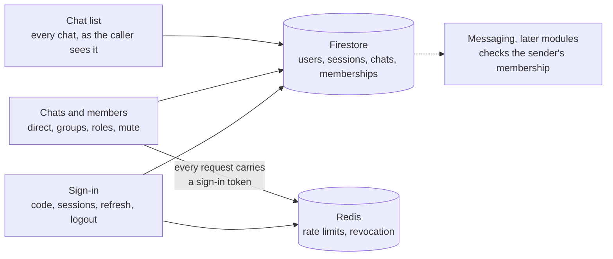

# Module 1: identity and membership

Module 1 lets a person **sign in with their phone number**, **talk to others** in direct chats and groups they manage, and **see all their chats** on one screen. Everything later in the platform builds on it: every message will be checked against the membership records kept here. Each document below describes one capability: what it does, its rules, its data, how we know it works, and how to operate it.

| Capability | What it covers |
|---|---|
| [Sign-in](sign-in.md) | One-time codes, account creation, sessions, token refresh and reuse detection, logout |
| [Chats and members](chats-and-members.md) | One direct chat per pair, groups up to 100, owner/admin/member, mute, authorization |
| [Chat list](chat-list.md) | The per-caller home screen in at most three database round trips |

## Operating basics

- **The tool:** [`scripts/inspect.sh`](../../scripts/inspect.sh), run from the repo root with `export PROJECT_ID=…` against a deployed stack. It's read-only, redacts the project ID and project number, and cuts secrets to 8 characters, so its output is safe to publish.
- **The base Logging filter:** `NS='resource.type="k8s_container" resource.labels.namespace_name="messaging"'`. Cloud Logging maps the app's `level` to `severity`.
- **Cloud Trace quota:** reads are scarce. A `ListTraces` call costs 25 of 300 units per minute ([quotas](https://cloud.google.com/trace/docs/quotas)), and an open Trace Explorer tab draws on the same quota. `inspect.sh` retries a 429.
- **Firestore's own metrics** work with PromQL (`firestore_googleapis_com:document_read_count`), with up to 240 s delay. On 2026-11-22 they showed 313 reads and 70 writes over 6 h, project-wide.
- **Dashboards:** deferred to the golden-signals work, because they would chart counter names that are about to change and there are no latency or per-RPC series yet.

## Open design questions

1. **Which plane owns Chat Mgmt?** ADR-002 names three planes and never mentions it, and ADR-012's metric prefixes don't fit any of the 10 existing counters. Options: a fourth plane, fold it into Durability, or a documented exception. This blocks the golden signals.
2. **What is the unit being measured?** The counters count events, the SLOs are per request, and the gates count operations. [Doubt] For this module the SLO unit should be the RPC request, by method and status, as `otelgrpc` would produce; per-user questions belong in traces and logs.
3. **Should any replayed renewal token end the session?** RFC 9700 treats any invalidated refresh token as a breach; we act only on the previous one, on bounded-storage grounds that may no longer hold now that sessions live in Firestore.

## Cross-cutting open items

| Item | Notes |
|---|---|
| Golden signals: naming decision, then `otelgrpc`, then a dashboard | No latency histogram or per-RPC rate and errors exist yet |
| A telemetry *gate* that asserts counter deltas | [`m1-telemetry.log`](../artifacts/evidence/m1-telemetry.log) reports values rather than asserting them |
| REST JSON conventions vs ADR-006 (envelope, enum names, `Timestamp`, omitted unset fields) | Affects every endpoint |
| Outdated comment: the code says GKE's managed OpenTelemetry has no gRPC endpoint | Google now lists `:4317`; the HTTP exporters still work |
| Teardown timing: deleting a Firestore TTL field takes ~6 min | At the next teardown: time each phase, try `terraform state rm` on the TTL fields first, then verify that nothing remains. The "destroy removes the database" claim is still unlogged |

## Lessons

1. **Decide what to measure before wiring export.** Traces and counters reached Google's backends before anyone chose the questions they answer.
2. **A gate must name the mechanism, not just the outcome.** "Exactly one chat" passed while the protection it was credited to never fired.
3. **Measure premises before building on them.** Twice, an ADR's reason was measured false.
4. **Some defects only exist in a live deploy:** an ungrantable permission, a blocked reissue, and booleans missing from REST responses.
5. **A claim without an artifact decays.** Three gates lived only in prose until they were logged.
6. **A passing Go test is silent.** To use a test as evidence, run it with `-v` and `t.Logf` the observed values.

**History:** first written as one Module 1 Feature Dossier (v1.0–v1.4, 2026-11-22), then split into these capability documents in PR #32. Milestone status lives in the [execution plan](../EXECUTION_PLAN.md).
