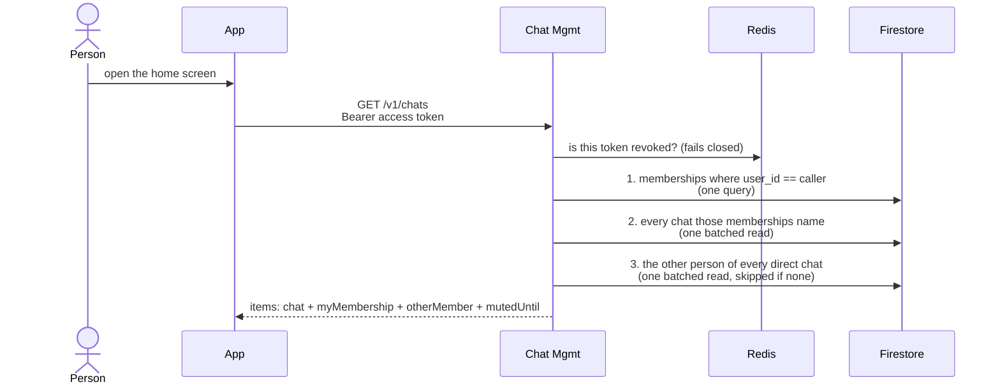
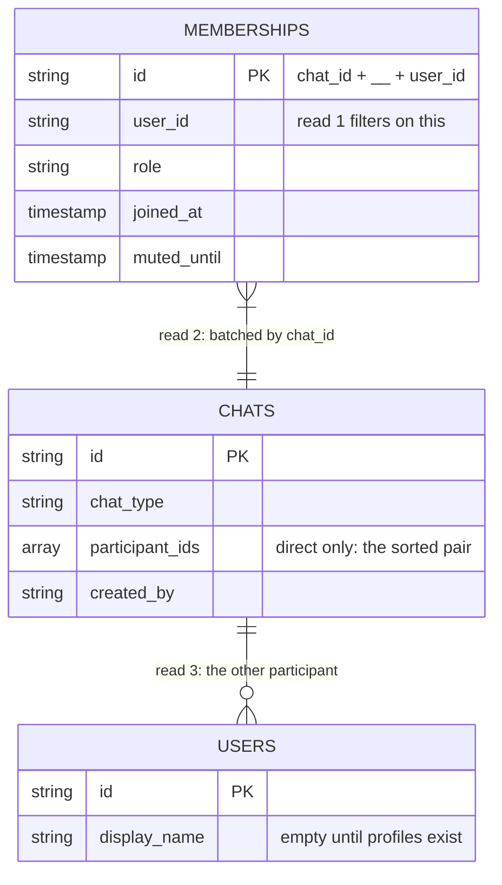

# Chat list: every chat, as the caller sees it

Part of [Module 1](README.md). Explanation: sections 1–3. Reference: sections 4–5. How-to: section 6.

## 1. What it does

The chat list is the app's home screen: every chat the person is in, each shown **from their point of view**. For each chat it says their role and when they joined, whether they muted it and until when, and, for a direct chat, **who the other person is**, since direct chats have no name of their own. The app can draw the whole screen from this one response, with no extra request per row. The whole list costs at most three database round trips, however many chats there are.

## 2. How it flows



## 3. The rules

| Rule | How it's enforced |
|---|---|
| A person sees only the chats they are a member of | The list starts from the caller's own membership documents; no chat is read any other way |
| Every item carries the caller's own role, join time and mute | `myMembership` and `mutedUntil` come from that caller's membership document |
| Every direct chat names the other person | `otherMember` is resolved from the chat's sorted `participant_ids`, so it works whichever side opened the chat |
| The list costs at most three round trips | One query plus two batched reads (`GetAll`), whatever the number of chats; the user read is skipped when there are no direct chats |
| One bad chat never breaks the list | A membership naming a missing chat is skipped and logged (`membership references a missing chat`); a direct chat that doesn't name exactly the caller and one other person gets no `otherMember` and is logged |
| The result never depends on the database's return order | Batched results are keyed by document ID, then re-walked in membership order |
| Old clients keep working | The deprecated `chats` field is filled alongside `items`, in the same order |

**Not yet true:** the list is not ordered by most recent activity, and it is not paginated. Today it comes back in membership document-ID order. See [Open items](#open-items).

## 4. Where the data lives



These commands reproduce by hand what one list call reads, for user A of the gate, including the direct chat that **C** opened. Today's output is from 2026-11-22:

```bash
scripts/inspect.sh where memberships user_id 8bb12951-a86b-4a6f-9a04-e30e654fd906   # read 1
scripts/inspect.sh doc chats/2dba3049-05cc-411f-9e76-73ff28623efe                    # one of read 2
scripts/inspect.sh pair 0d102d9c-cb07-4e18-abd6-f16aca9d269a 8bb12951-a86b-4a6f-9a04-e30e654fd906
```
```
{"id":"memberships/290614a1-…__8bb12951-…","fields":{"role":"member","joined_at":"…15:59:06.382593Z","muted_until":null,…}}
{"id":"memberships/2dba3049-…__8bb12951-…","fields":{"role":"member","joined_at":"…15:59:06.725594Z","muted_until":null,…}}
{"id":"memberships/6cd6c32d-…__8bb12951-…","fields":{"role":"owner","joined_at":"…15:59:05.808460Z","muted_until":"2026-11-23T15:59:06.186728Z",…}}
{"id":"chats/2dba3049-…","updateTime":"…15:59:06.867636Z","fields":{"created_by":"0d102d9c-cb07-4e18-abd6-f16aca9d269a","participant_ids":["0d102d9c-…","8bb12951-…"],"chat_type":"direct","member_count":2,"name":"",…}}
{"id":"direct_chats/0d102d9c-…__8bb12951-…","updateTime":"…15:59:06.867636Z","fields":{"chat_id":"2dba3049-05cc-411f-9e76-73ff28623efe",…}}
```

`created_by` is C, so naming C as A's `otherMember` can only have come from `participant_ids`: the peer-opened case is real. The three memberships come back in document-ID order (`290614…`, `2dba…`, `6cd6…`), which is exactly the order of the list's items in the gate log.

What the list returned for A (from [`m1.3-listchats.log`](../artifacts/evidence/m1.3-listchats.log), one item shown):

```
{"chatId":"2dba3049-…","chatType":"CHAT_TYPE_DIRECT","memberCount":2,"myMembership":{"role":"MEMBER_ROLE_MEMBER","joinedAt":{"millis":"1795363146725"}},"otherMember":{"userId":"0d102d9c-cb07-4e18-abd6-f16aca9d269a","displayName":""}}
```

## 5. How we know it works

| Signal | Query | Today |
|---|---|---|
| Metric | none of its own | The chat list has no counter; its signal is the trace |
| Trace | `root:chat.list` | `2c3f3d8b…`, **50.7 ms, 3 Firestore spans**: `membership.list_by_user` 16.5 ms (`RunQuery`), `chat.get_many` 26.4 ms (`BatchGetDocuments`), `user.get_many` 7.8 ms (`BatchGetDocuments`) |
| Log | `jsonPayload.trace_id="2c3f3d8b…"` | nothing: a successful list doesn't log |

**Evidence:** [`m1.3-listchats.log`](../artifacts/evidence/m1.3-listchats.log), the gate against the deployed pod: 3 items, the correct `myMembership` on each, `otherMember` correct on both direct chats (including the one the peer opened), `mutedUntil` on the muted group, and the deprecated field in the same order. It also carries the span tree above.

**Observed, not defects:**
- `otherMember.displayName` is empty, because people who signed in by phone have no profile name yet.
- An unmuted item *omits* `mutedUntil` rather than returning `null`. That's the API-wide JSON convention gap listed in the README.

**Not measured:**
- a 500-chat list (only 3 chats ran);
- document read counts (the trace shows calls, not documents);
- the payload size with both fields;
- the missing-chat skip against a live store (unit-tested only).

## 6. How to operate and debug it

**A chat is missing from someone's list.**
1. `scripts/inspect.sh doc memberships/<chat-id>__<user-id>`. A 404 means they are not a member, so the list is right.
2. If the membership exists, `scripts/inspect.sh doc chats/<chat-id>`. A 404 here is cross-store drift: the list skips the chat and logs it. Find the log line with `scripts/inspect.sh logs "$NS jsonPayload.msg=\"membership references a missing chat\""`.

**A direct chat shows no other person.**
1. Read the chat. `participant_ids` must hold exactly the caller and one other user; anything else is logged as `direct chat does not name the caller and one other participant`.
2. A blank *name* with a correct `userId` is expected today, because there are no profile names.

**The list is slow.** Find the trace (`scripts/inspect.sh trace 'root:chat.list'`) and count the `firestore.*` spans. More than three is a regression; the gate asserts at most three. Then see which span dominates.

**The order looks random.** It is document-ID order today (open item), not recency.

**Code:** [`internal/chatmgmt/app/chat_service.go`](../../internal/chatmgmt/app/chat_service.go) (`ListChats`: the three reads, keyed and re-walked), [`internal/firestore/stores.go`](../../internal/firestore/stores.go) (`Chats.GetMany`, `Users.GetMany` and the shared `getMany` that drops missing documents), [`internal/chatmgmt/port/chat_handler.go`](../../internal/chatmgmt/port/chat_handler.go) (`chatListItemToProto`: the per-caller fields).

## Open items

| Item | Notes |
|---|---|
| Order by most recent activity, and paginate | ADR-006 §4.2 says "Results ordered by `updated_at` descending"; today it's document-ID order with no pagination |
| `last_message`, `pending_ack_count` | Wait on M2.2 and `delivery_state` (the Postgres tables) |
| Remove the deprecated `chats` field | It doubles the payload. Removing it needs a signal that no client still reads it |
| A 500-chat batch read | Parked: it needs a harness that seeds 500 memberships, which belongs with load tooling |

## Decisions and sources

- **Governing ADRs:** [ADR-006](../adr/ADR-006.md) §4.2 (List Chats: "For direct chats, `other_member` provides the other participant's info"); [ADR-023](../adr/ADR-023.md) v1.5, which adds `participant_ids` to direct chats as a **field**. The disclosure argument it answers is about chat **IDs** derived from members, because IDs travel; a field does not. Plan: [`EXECUTION_PLAN.md`](../EXECUTION_PLAN.md), M1.3 open item 1.
- **[Firestore REST `batchGet`](https://cloud.google.com/firestore/docs/reference/rest/v1/projects.databases.documents/batchGet):** "Documents returned by this method are not guaranteed to be returned in the same order that they were requested." Agree by construction: results are keyed by ID.
- **[Go client `Client.GetAll`](https://pkg.go.dev/cloud.google.com/go/firestore#Client.GetAll):** returns snapshots in request order, one per reference, with a missing document reported through `Exists()`. Agree: missing chats are filtered on `!Exists()`. The order guarantee belongs to the client library, not the wire API, so we don't rely on it. Neither source states a per-call maximum, hence the parked 500-chat test.

**History:** implemented on `feat/m1.3-listchats-membership` (PR #32, in review); gate met live on 2026-11-22. Previously part of the Module 1 Feature Dossier v1.0–v1.4.
