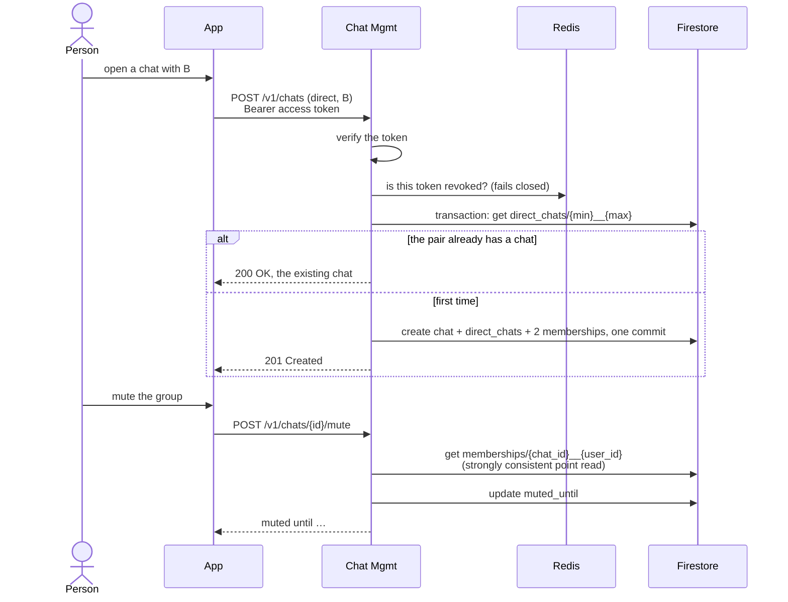
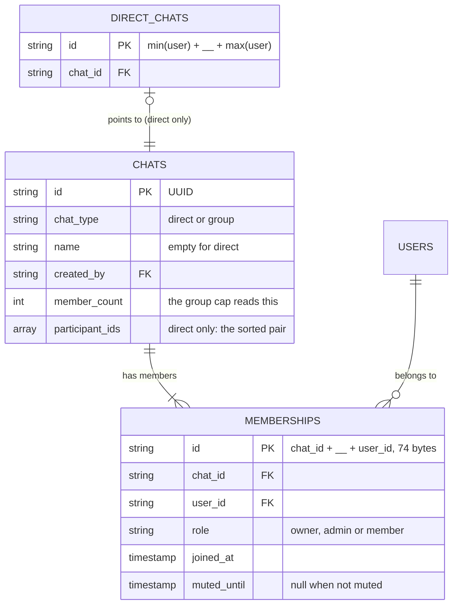

# Chats and members: direct chats, groups, roles, mute

Part of [Module 1](README.md). Explanation: sections 1–3. Reference: sections 4–5. How-to: section 6.

## 1. What it does

A signed-in person can open a **direct chat** with one other person, or create a **group** of up to 100 people. Two people always share **one** direct chat: opening it again, from either side, returns the same conversation. A group has one **owner** (its creator), any number of **admins**, and **members**. The owner and admins manage who is in the group and what it is called, and the owner decides who is an admin. Anyone in a chat can **mute** it for a while or indefinitely, which affects only them. Every action is checked against the person's **stored** membership, never against what the request claims.

## 2. How it flows



## 3. The rules

Numbers are set in [`internal/domain/constants.go`](../../internal/domain/constants.go) (`constants.go:N`). `chat_service.go` is `internal/chatmgmt/app/chat_service.go`, and `chat_tx.go` is `internal/firestore/chat_tx.go`.

| Rule | How it's enforced, and where |
|---|---|
| Only signed-in, non-revoked callers reach any chat action | Every RPC passes `AuthenticatedChatServer.authenticate`: token check, then the Redis revocation list, failing closed (`internal/chatmgmt/port/authenticated_chat.go:100`, `:111`) |
| One direct chat per pair, whichever side opens it (`MaxDirectChatsPerPair = 1`, `constants.go:15`) | `direct_chats/{min(a,b)}__{max(a,b)}` is read and created inside the creating transaction (`chat_tx.go:98–99`, `readDirectPair` `:147`); a repeat returns the existing chat (200, not 409) |
| You can't open a direct chat with yourself | Refused before any write (`chat_tx.go:88`) |
| A direct chat's two members never change | Add, remove, leave and role changes are refused on direct chats (`chat_tx.go:350`, `:433`, `:497`) |
| A group holds at most 100 members (`MaxGroupSize`, `constants.go:13`) | At most 99 others at creation (`chat_service.go:800`); the count is checked in the creating transaction (`chat_tx.go:265`) and in every add's transaction (`chat_tx.go:355`) |
| Only members can see or act on a chat | Each action does a strongly consistent point read of `memberships/{chat_id}__{user_id}`; a non-member gets `ErrNotMember` (`chat_service.go:440–448`) |
| Owner and admins rename a group | `requireRole(…, RoleOwner, RoleAdmin)` (`chat_service.go:496`) |
| The owner can add anyone as member or admin; an admin can add only plain members | `chat_service.go:540` |
| The owner can remove anyone except themselves; an admin only plain members | `chat_service.go:584–594`, reading the target's stored role |
| Only the owner changes roles; nobody can change their own role; nobody can be made owner | `requireRole(…, RoleOwner)` (`chat_service.go:636`); self-change refused (`:626`); `IsAssignableRole` admits only admin and member (`constants.go:150`) |
| The owner can't leave or be removed | Refused inside the removal transaction (`chat_tx.go:452`); owner transfer does not exist |
| Removing yourself is "leave", not "remove" | Self-removal through the remove endpoint is refused (`chat_service.go:573`) |
| A timed mute lasts 1 to 8,760 hours (`MaxMuteDurationHours`, `constants.go:18`), or it can be indefinite | Out-of-range durations are refused (`chat_service.go:690`); indefinite is stored as `9999-01-01` (`IndefiniteMuteUntil`, `constants.go:164`), because `null` means "not muted" |

## 4. Where the data lives



One membership document answers three questions: "is X in Y?" is a point read on its ID, and "who is in Y?" and "what is X in?" are equality queries on `chat_id` and `user_id`. Inspect them with [`scripts/inspect.sh`](../../scripts/inspect.sh); today's output is from 2026-11-22, using the ListChats gate's users (A `8bb12951…`, B `49d25070…`, C `0d102d9c…`):

```bash
scripts/inspect.sh pair 49d25070-2951-46ec-be78-669159815ac9 8bb12951-a86b-4a6f-9a04-e30e654fd906   # order doesn't matter
scripts/inspect.sh doc chats/290614a1-6932-4c3c-8e47-9fbe85c671f8
scripts/inspect.sh where memberships chat_id 6cd6c32d-810b-4246-bd83-cae37679110f
```
```
{"id":"direct_chats/49d25070-…__8bb12951-…","updateTime":"…15:59:06.448209Z","fields":{"chat_id":"290614a1-6932-4c3c-8e47-9fbe85c671f8","created_at":"…15:59:06.382593Z"}}
{"id":"chats/290614a1-…","updateTime":"…15:59:06.448209Z","fields":{"created_by":"8bb12951-…","member_count":2,"name":"","participant_ids":["49d25070-…","8bb12951-…"],"chat_type":"direct",…}}
{"id":"memberships/6cd6c32d-…__0d102d9c-…","updateTime":"…15:59:05.878702Z","fields":{"role":"member","joined_at":"…15:59:05.808460Z","muted_until":null,…}}
{"id":"memberships/6cd6c32d-…__49d25070-…","updateTime":"…15:59:05.878702Z","fields":{"role":"member","joined_at":"…15:59:05.808460Z","muted_until":null,…}}
{"id":"memberships/6cd6c32d-…__8bb12951-…","updateTime":"…15:59:06.211316Z","fields":{"role":"owner","joined_at":"…15:59:05.808460Z","muted_until":"2026-11-23T15:59:06.186728Z",…}}
```

The direct chat and its pair document were written in one commit (same `updateTime`); so were the group and its members. The owner's membership is newer because muting rewrote it. The derived membership ID is 74 bytes: two 36-byte UUIDs and `__` ([`m1.1-store.log`](../artifacts/evidence/m1.1-store.log)).

## 5. How we know it works

| Signal | Query | Today |
|---|---|---|
| Chats created | `sum by (chat_type) (chat_created_total)` | `direct` 2, `group` 1 |
| Direct-chat dedup | `sum by (result) (direct_chat_dedup_total)` | `created` 2; no `existing` (summed without the label it misreads as "2 dedups") |
| Membership changes | `sum by (change_type) (membership_mutation_total)` | `muted` 1 |
| Refusals | `scripts/inspect.sh prom 'sum by (operation, reason) (chat_authz_denials_total)'` | **no series**, which means zero refusals: an OpenTelemetry counter has no series until its first increment, and nothing today attempted a forbidden action |
| Trace | `root:chat.create` | `2dc313a5…`, 192.7 ms: the transaction 146.2 ms (begin 73.5, read 28.7, commit 43.7), then `list_by_chat` 24.5 ms, then **two `firestore.user.get` in sequence** (7 ms, 14.9 ms) |
| Trace | `span:firestore.membership.get` | `a564c0b5…`: `chat.mute` 45.9 ms, a 17.7 ms point read, then a 28.1 ms update |
| Log | `jsonPayload.msg="chat.create"` | 3 lines (`direct` ×2, `group`), all `"existing":false`, each with the `trace_id` of its trace |

**Evidence logs:**
- [`m1.3-store.log`](../artifacts/evidence/m1.3-store.log): the chat-store gate. Concurrent direct creation yields exactly one chat, and the log records which mechanism refused each loser.
- [`m1.3-store-membership.log`](../artifacts/evidence/m1.3-store-membership.log): the group cap with the count still exact, direct-chat immutability, and the indefinite-mute sentinel (`9999-01-01`) surviving a live round trip.
- [`m1.3-direct-pair-pessimistic.log`](../artifacts/evidence/m1.3-direct-pair-pessimistic.log) and [`-optimistic.log`](../artifacts/evidence/m1.3-direct-pair-optimistic.log): the race experiment. The sentinel refused **zero** racers in 30, so it is kept as a lookup rather than as the lock.
- [`m1.3-flow.log`](../artifacts/evidence/m1.3-flow.log): 22 steps against the deployed pod (2026-09-20), including "member left; the owner was refused".

**Not measured:** per-RPC latency, rate and errors (the gRPC server is not instrumented); load behaviour.

## 6. How to operate and debug it

**A direct chat seems duplicated.**
1. `scripts/inspect.sh pair <user-a> <user-b>` gives the one chat the pair maps to.
2. `scripts/inspect.sh where memberships user_id <user-a>` lists every chat A is in. Read each candidate with `doc chats/<id>`; a true duplicate is a second `direct` chat whose `participant_ids` is the same pair. None has ever been observed.
3. `sum by (result) (direct_chat_dedup_total)`: `existing` counts the creates that correctly returned the old chat.

**A user gets "forbidden" or "not a member".**
1. `scripts/inspect.sh doc memberships/<chat-id>__<user-id>`. A 404 means they are not a member; otherwise `role` decides (see the rules).
2. `sum by (operation, reason) (chat_authz_denials_total)` shows which action is being refused, and how often.

**A member can't be added.** Read the chat: `member_count` 100 means the group is full. A direct chat never accepts members.

**Mute seems not to apply.** Read the membership: `muted_until` must be in the future. `9999-01-01` means "indefinite"; `null` means not muted.

**Find the log line for a slow create.** Take the `trace_id` from the trace and run `scripts/inspect.sh logs "$NS jsonPayload.trace_id=\"<id>\""`.

**Code:** [`internal/chatmgmt/app/chat_service.go`](../../internal/chatmgmt/app/chat_service.go) (every action and its authorization), [`internal/firestore/chat_tx.go`](../../internal/firestore/chat_tx.go) (`CreateDirect`, `CreateGroup`, the in-transaction cap, removal), [`internal/chatmgmt/port/authenticated_chat.go`](../../internal/chatmgmt/port/authenticated_chat.go) (token and revocation check).

## Open items

| Item | Notes |
|---|---|
| **`CreateChat` reads members one at a time** | The response is built with one sequential `firestore.user.get` per member (trace `2dc313a5…`); `GetChat` has the same cost. A batched read, as the chat list uses, would make it one round trip |
| Owner transfer | Out of scope, which is why the owner can't leave |
| Sentinel negative control | Parked: the sentinel never fires (0 of 30), so a control that removes it would show nothing |
| Idempotency-Key for REST creates | Planned as M1.4 (ADR-006 v1.1 §10.4–§10.5) |

## Decisions and sources

- **Governing ADRs:** [ADR-016](../adr/ADR-016.md) §8, the authorization matrix, where "All checks are performed by the Chat Mgmt Service with `ConsistentRead=true` on the caller's membership record"; [ADR-023](../adr/ADR-023.md) v1.4–v1.5, the Firestore model (`direct_chats` is "a lookup, not only a sentinel"; the measured result that it never fires is recorded there); [ADR-006](../adr/ADR-006.md) §4.1, where an existing direct chat returns 200. Plan: [`EXECUTION_PLAN.md`](../EXECUTION_PLAN.md), M1.1 and M1.3.
- **[Firestore transaction serializability and isolation](https://cloud.google.com/firestore/docs/transaction-data-contention):** agree; the group cap relies on the documented pessimistic lock on the chat document it reads. **Differ, knowingly:** we measured that a query matching nothing was also protected, which the page neither promises nor denies, so the design does not rely on it.
- **[Firestore best practices](https://cloud.google.com/firestore/docs/best-practices):** agree; IDs are random UUIDs, not monotonic, so the composite IDs start with a random prefix.
- **[Firestore quotas and limits](https://cloud.google.com/firestore/docs/quotas):** agree; 74 bytes is far below the 1,500-byte ID limit, and `__` is used only as an inner separator, never in the reserved `__.*__` form.
- [Inference] The pair document follows the "uniqueness claim" pattern (a key whose existence is the lock); no single primary source names it, so none is cited.

**History:** Firestore tier PR #14 (2026-07-26); chats and membership PRs #22, #24–#29 (2026-08-12 to 2026-09-20), with #23 the ADR-023 v1.4 amendment; live logs 2026-08-10 to 2026-09-20 and the PR #32 live session 2026-11-22. Previously part of the Module 1 Feature Dossier v1.0–v1.4.
