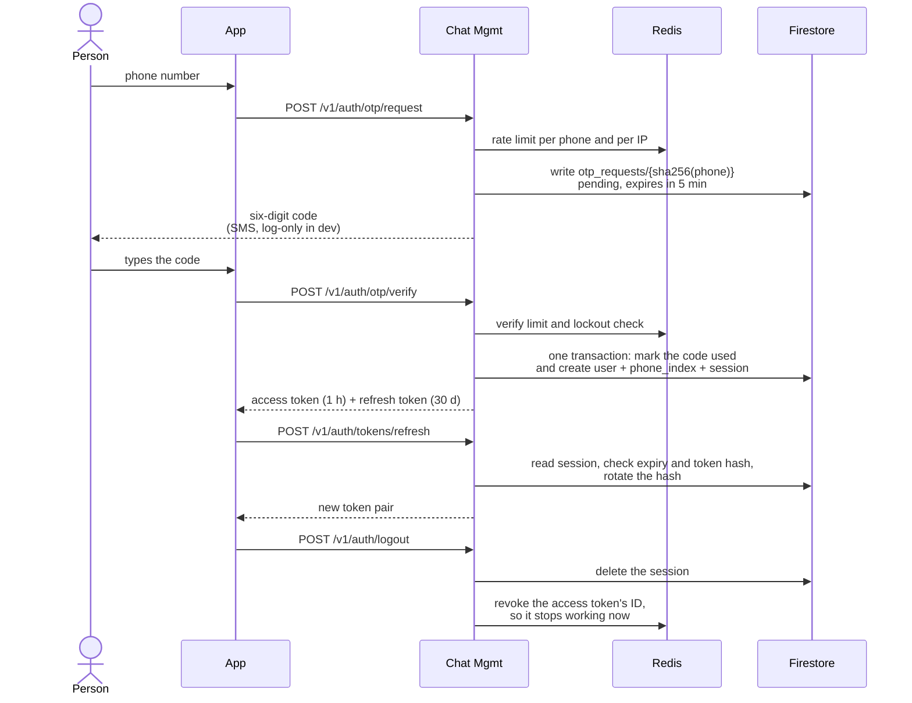
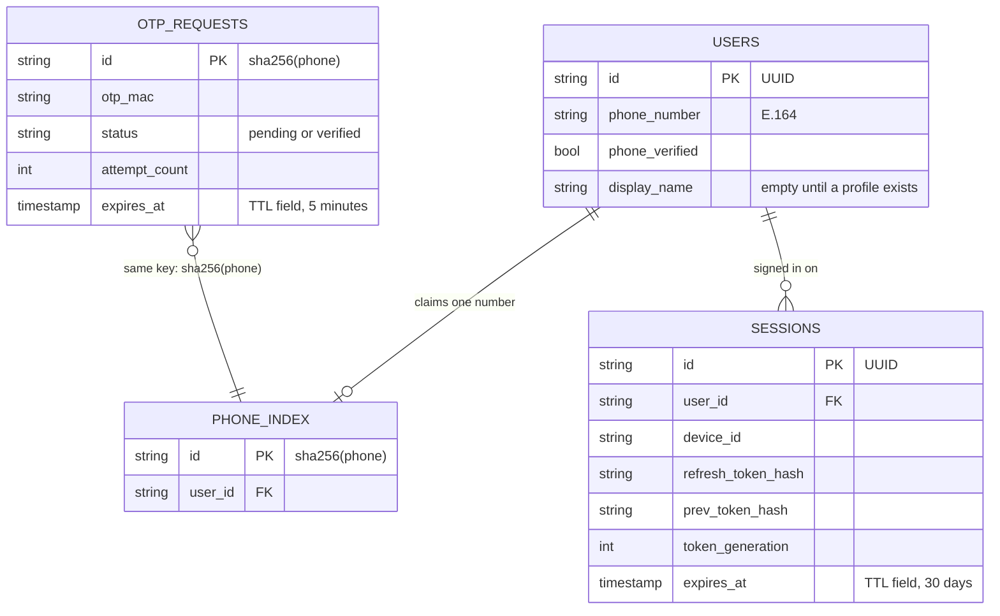

# Sign-in: phone number, one-time code, sessions

Part of [Module 1](README.md). Explanation: sections 1–3. Reference: sections 4–5. How-to: section 6.

## 1. What it does

A person signs in with their phone number. They ask for a code, receive a six-digit one-time code, and type it back. The first time, this **creates their account**; after that, it **signs them in** on a new device. Each signed-in device holds a **session**: a short-lived access pass (1 hour) that every other request carries, and a long-lived renewal pass (30 days) the app uses to get a fresh access pass without asking for a code again. Signing out ends the session at once. If a renewal pass is ever used twice, which suggests someone copied it, the session is ended for everyone holding it.

## 2. How it flows



## 3. The rules

| Rule | How it's enforced |
|---|---|
| A code is valid for 5 minutes and can be used once | `expires_at` and `status` are checked in code on every verify; a used code is kept as `verified` so replaying it is refused rather than mistaken for "never issued" |
| An expired code can never be used, even while it is still stored | Expiry is checked in code; the Firestore TTL policy on `expires_at` only cleans up, within about 24 h |
| A live code is not replaced by asking again | Asking again while a code is pending returns the existing one (`status="existing"`) |
| Guessing is limited | Redis allows 5 verify attempts per phone per 15 minutes, and 3 code requests per phone (10 per IP) per 15 minutes |
| One account per phone number | Registration does `tx.Create` on `phone_index/{sha256(phone)}`, which fails if the number is already claimed |
| Registration is all or nothing | The user, the sentinel, the session and the used code commit in one transaction |
| At most 5 sessions per person | Signing in on a sixth device deletes and revokes the oldest session (`reason="session_limit"`) |
| Expired sessions don't work, even before TTL removes them | Every refresh checks `expires_at` in code (`SessionDoc.IsExpired`) |
| A renewal pass works once | Each refresh rotates the stored hash; the previous hash is kept to recognise a replay |
| A replayed renewal pass ends the session | Presenting the *previous* token revokes the whole session |
| Signed-out tokens stop working immediately | Logout deletes the session and puts the access token's ID (JTI) on the Redis revocation list, which every chat request checks |
| If Redis is down, access is denied, not granted | Rate-limit and revocation checks fail closed |

**Known defect:** asking for a new code after the old one expires **resets the failed-attempt count**, so the attempt-based lockout never fires. The Redis verify limit still stops guessing at 5 per 15 minutes. See [Open items](#open-items).

## 4. Where the data lives



Inspect with [`scripts/inspect.sh`](../../scripts/inspect.sh) (read-only; it redacts the project and masks secrets; see the [README](README.md#operating-basics)). Today's output is from 2026-11-22, user A of the ListChats gate:

```bash
scripts/inspect.sh doc users/8bb12951-a86b-4a6f-9a04-e30e654fd906
scripts/inspect.sh where sessions user_id 8bb12951-a86b-4a6f-9a04-e30e654fd906
scripts/inspect.sh otp +525543450        # otp_requests/{sha256(phone)}
scripts/inspect.sh phone +525543450      # phone_index/{sha256(phone)}
```
```
{"id":"users/8bb12951-…","updateTime":"…15:58:59.226298Z","fields":{"display_name":"","phone_number":"+525543450","phone_verified":true,"created_at":"…15:58:59.081335Z"}}
{"id":"sessions/e2d2edfa-…","updateTime":"…15:58:59.226298Z","fields":{"user_id":"8bb12951-…","device_id":"lc-a","refresh_token_hash":"a4950cdf…","prev_token_hash":"…","token_generation":1,"created_at":"2026-11-22T15:58:59.081335Z","expires_at":"2026-12-22T15:58:59.081335Z"}}
{"id":"otp_requests/4f5468b2…","updateTime":"…15:58:59.226298Z","fields":{"attempt_count":0,"otp_mac":"bcb25535…","expires_at":"…16:03:56Z","created_at":"…15:58:56Z","status":"verified"}}
{"id":"phone_index/4f5468b2…","updateTime":"…15:58:59.226298Z","fields":{"user_id":"8bb12951-…","created_at":"…15:58:59.081335Z"}}
```

The four documents share one `updateTime`: registration committed them together. The session expires exactly 30 days after creation. `prev_token_hash: "…"` is an empty value printed by an early version of the masking; the tool now prints `""`. The TTL policies are listed with `gcloud firestore fields ttls list --database=messaging-dev`, which returns both as `state: ACTIVE` ([`m1.1-store.log`](../artifacts/evidence/m1.1-store.log)).

## 5. How we know it works

| Signal | Query | Today (since the pod started, ~15:58 UTC) |
|---|---|---|
| Codes requested | `sum by (status) (auth_otp_requests_total)` | `success` 8, `existing` 1 |
| Sessions created | `sum by (flow) (auth_session_created_total)` | `registration` 4, `login` 1 |
| Failures | `sum by (reason) (security_auth_failures_total)` | `invalid_otp` 6, `refresh_token_reuse` 1, `session_expired` 1 |
| Rate limits hit | `sum by (endpoint, limit_type) (security_rate_limits_total)` | `verify_otp`/`phone` 5, `request_otp`/`phone` 1 |
| Sessions ended | `sum by (reason) (security_session_revocations_total)` | `reuse_detection` 1, `logout` 1 |
| Trace | `root:auth.verify_otp` | `30de4a49…`: rate-limit, Firestore and SDK child spans ([`m1-telemetry.log`](../artifacts/evidence/m1-telemetry.log)) |
| Trace | `root:auth.refresh_tokens` | `392da3e3…`: 7.2 ms, `firestore.session.get` only, so the session was not found |
| Log | `jsonPayload.msg="auth.refresh_token_reuse"` | one `WARNING` line at 15:59:22 with `session_id` and `trace_id` |

**Evidence logs:**
- [`m1.2-flow.log`](../artifacts/evidence/m1.2-flow.log): the deployed flow, 7 of 7 steps.
- [`m1.2-store.log`](../artifacts/evidence/m1.2-store.log): live store tests, including concurrent registrations yielding one user.
- [`m1.2-otp-reissue.log`](../artifacts/evidence/m1.2-otp-reissue.log): the defect.
- [`m1.1-store.log`](../artifacts/evidence/m1.1-store.log): session round trip; an expired session still reads back with `IsExpired=true`.
- `rtm-04-negative-control*.log`: why the `phone_index` sentinel is needed.

**Not measured:** auth latency (no histogram; span durations only); Redis being down end to end (unit-tested only); guessing over horizons longer than one 15-minute window.

## 6. How to operate and debug it

**A user says their code doesn't work.**
1. `scripts/inspect.sh otp <phone>`. If `status` is `verified`, the code was already used. If `expires_at` is in the past, it expired; they must ask again. `attempt_count` shows how many wrong guesses this code has had.
2. If they get HTTP 429, they hit a Redis limit. Check `sum by (endpoint, limit_type) (security_rate_limits_total)`; the window is 15 minutes.
3. In dev there is no SMS: the code is in the pod log, `jsonPayload.msg="otp delivery (log-only)"` (the code is masked by `inspect.sh logs`).

**A user was signed out unexpectedly.**
1. `scripts/inspect.sh where sessions user_id <user-id>`. A missing session means logout, eviction by a sixth sign-in, or reuse detection.
2. `scripts/inspect.sh logs "$NS jsonPayload.msg=\"auth.refresh_token_reuse\" jsonPayload.user_id=\"<user-id>\""`. A line here means a renewal pass was replayed and the session was revoked on purpose.
3. Check `security_session_revocations_total` by `reason`. A refused refresh itself writes **no log line**; only the metric records it (open item).

**Someone may have stolen a token.** Find the session with the `where` query above, and have the user sign out (`POST /v1/auth/logout`), which deletes the session and revokes the access token in Redis. Without the session document, the stolen renewal pass can no longer refresh. There is no operator "revoke" command yet.

**Check that expiry cleanup is configured.** `docker compose run --rm -T toolbox gcloud firestore fields ttls list --database=messaging-dev --project="$PROJECT_ID"` lists both `expires_at` policies as `ACTIVE`. Cleanup lags by up to a day; that is expected and harmless, because expiry is checked in code.

**Code:** [`internal/chatmgmt/app/auth_verify_otp.go`](../../internal/chatmgmt/app/auth_verify_otp.go) (limits, lockout, register or log in), [`internal/chatmgmt/app/auth_refresh.go`](../../internal/chatmgmt/app/auth_refresh.go) (expiry, rotation, reuse), [`internal/firestore/auth_tx.go`](../../internal/firestore/auth_tx.go) (the single-commit `Register` and `Login`).

## Open items

| Item | Notes |
|---|---|
| **Defect: a new code resets the failed-attempt count** | Confirmed live, `m1.2-otp-reissue.log` (4 → 0; lockout never fires). NIST SP 800-63B: "Generating a new authentication secret SHALL NOT reset the failed authentication count." Fix in its own PR |
| **`session_expired` also counts revoked sessions** | A refresh whose session document is gone returns `ErrSessionRevoked` but is counted as `reason="session_expired"` (`auth_refresh.go:38–40`). Seen 2026-11-22 |
| **A refused refresh writes no log line** | Trace `392da3e3…` has no Cloud Logging entry; only the metric records it |
| Older replayed tokens don't revoke | Only the immediately previous token triggers revocation; see the README's open design questions |
| No SMS provider | `LogSMSProvider` only; the PSTN requirements of NIST 800-63B are not yet live |

## Decisions and sources

- **Governing ADRs:** [ADR-015](../adr/ADR-015.md) §1.2 (code generation), §4.2 (rotation with reuse detection: on the previous token, "REVOKE ENTIRE SESSION"); [ADR-013](../adr/ADR-013.md) (security-critical Redis paths fail closed); [ADR-023](../adr/ADR-023.md) (Firestore model: `otp_requests`, `phone_index`, `sessions`; TTL is collection, never the correctness gate). Plan: [`EXECUTION_PLAN.md`](../EXECUTION_PLAN.md), M1.1 and M1.2.
- **[NIST SP 800-63B Rev. 4](https://pages.nist.gov/800-63-4/sp800-63b.html):** agree on the 10-minute ceiling (ours is 5) and on rate limiting a short secret; **differ** on resetting the count (the defect above).
- **[RFC 9700](https://www.rfc-editor.org/rfc/rfc9700) §2.2.2, §4.14:** agree on rotation and revoke-on-reuse; differ in scope (previous token only).
- **[RFC 7519](https://www.rfc-editor.org/rfc/rfc7519) §4.1.4:** access tokens carry `exp`, with a 1 h lifetime. **[RFC 8725](https://www.rfc-editor.org/rfc/rfc8725) §3.1:** the verifier pins RS256 and never trusts the token's own `alg`.
- **[Firestore TTL](https://cloud.google.com/firestore/docs/ttl):** "Expired documents continue to appear in queries and lookup requests until the TTL process actually deletes them". This is why expiry is checked in code.

**History:** Firestore tier PR #14 and auth PR #15, both merged 2026-07-26. Live store tests 2026-08-04; deployed flow, defect probe and telemetry captured in the PR #32 live session, 2026-11-22. Earlier write-ups were the Module 1 Feature Dossier v1.0–v1.4 (same day), replaced by these capability docs.
